# 2. Bastion Host (Debian 13)

[⬅️ Anterior: Firewall pfSense](Firewall_Checho.md) · [Volver al README](README.md) · [Siguiente: Active Directory ➡️](ActiveDirectory_Checho.md)

El Bastion Host (`bastion01`) es el único punto de entrada administrativo por SSH. Se instala con lo mínimo indispensable y se endurece con MFA (TOTP), llaves SSH, `ufw`, `fail2ban` y AppArmor.

## Contenido

- [Especificaciones](#especificaciones)
- [Instalación](#instalación)
- [Acceso a los repositorios con reglas mínimas en pfSense](#acceso-a-los-repositorios-con-reglas-mínimas-en-pfsense)
- [Herramientas básicas](#herramientas-básicas)
- [AppArmor](#apparmor)
- [Hardening: ufw, MFA, SSH y fail2ban](#hardening-ufw-mfa-ssh-y-fail2ban)
- [Autenticación con llave pública + MFA](#autenticación-con-llave-pública--mfa)
- [Mejoras futuras](#mejoras-futuras)

## Especificaciones

| Parámetro | Valor |
| --------- | ----- |
| Hostname / FQDN | `bastion01` / `bastion01.lab.internal` |
| Sistema operativo | Debian 13.4 (sin entorno gráfico) |
| RAM / Disco | 2 GB / 20 GB |
| Red | Management – `10.0.40.0/28` (interfaz OPT3 en pfSense) |
| IP | `10.0.40.10` |
| Gateway / DNS | `10.0.40.1` (DNS de respaldo: `8.8.8.8`) |
| Admin VM (cliente SSH) | `10.0.40.11` |

> Un bastion no necesita muchos recursos: debe correr lo mínimo posible para reducir la superficie de ataque.

---

## Instalación

### Red

Como aún no hay reglas en el firewall para esta subred, la VM no tendrá conectividad por DHCP, así que la red se configura manualmente durante la instalación:

- Gateway y DNS: `10.0.40.1` (cuando el DNS de Active Directory esté listo se cambiará aquí).
- DNS de respaldo: `8.8.8.8`.
- Dominio: `lab.internal` (entorno local de pruebas), con lo que el FQDN queda `bastion01.lab.internal`.

### Usuarios

Dejar **vacía la contraseña de `root`**. Así Debian bloquea el acceso directo como root y agrega al usuario inicial al grupo `sudo`.

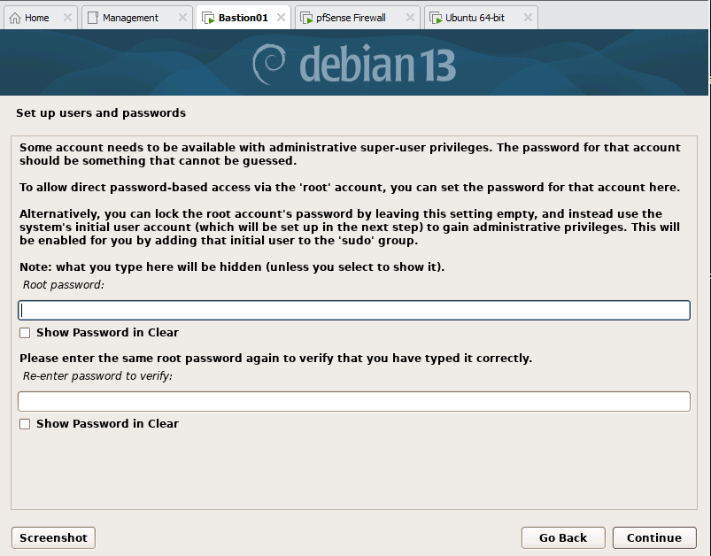

Luego el instalador pide crear un usuario sin privilegios (con acceso temporal a privilegios mediante `sudo`):

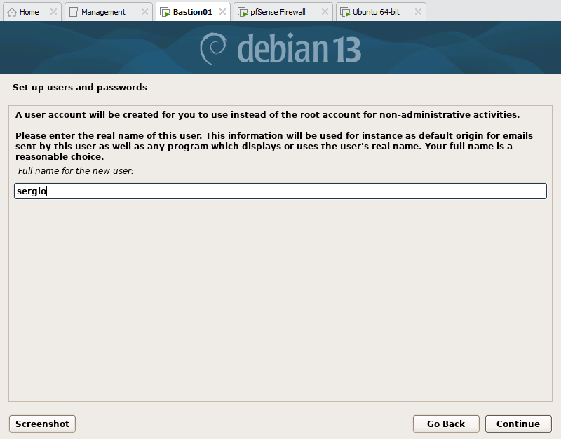

### Gestor de paquetes y proxy

- Mirror: Estados Unidos → `deb.debian.org`.
- Proxy: ninguno por ahora. Más adelante se puede desplegar Squid, Burp Suite o mitmproxy para practicar web filtering, inspección de tráfico, malware sandboxing o simular un entorno corporativo.

Para que la instalación descargue paquetes, se crea **temporalmente** en pfSense una regla que permite todo el tráfico IPv4 de la subred Management hacia afuera. Esta regla se deshabilita después (ver más abajo) y se reemplaza por reglas que solo permiten lo necesario.

### Selección de software

Marcar únicamente **SSH server** y **standard system utilities**. OpenSSH da administración remota, shell segura, túneles SSH y SCP/SFTP.

No se instala entorno gráfico: es más pesado, más difícil de endurecer y amplía la superficie de ataque.

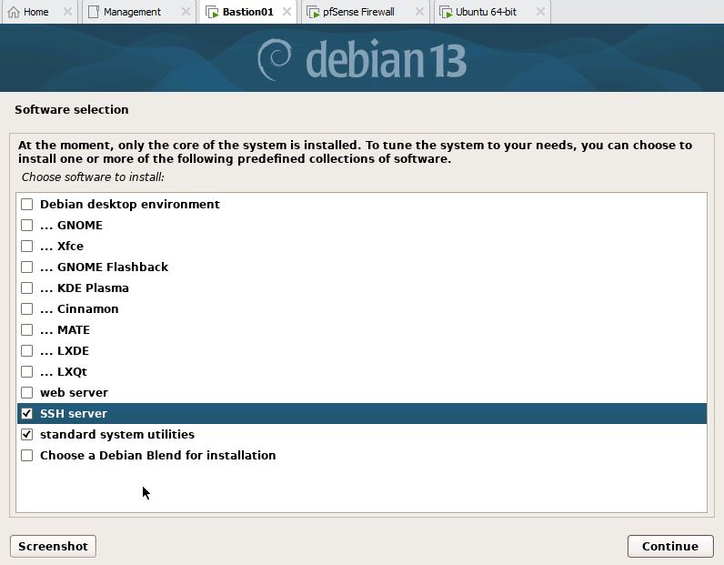

### Finalizar

Instalar el gestor de arranque GRUB (es el único sistema operativo de la VM), reiniciar e iniciar sesión con el usuario creado.

Servicios en ejecución tras la instalación mínima:

```bash
systemctl list-units --type=service --state=running
```

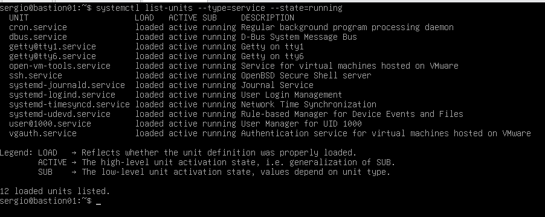

### Verificar conectividad y actualizar

```bash
ip a
ip route          # debe mostrar el default gateway configurado
ping 10.0.40.1
ping 8.8.8.8
ping google.com

sudo apt update && sudo apt upgrade -y
```

Después de actualizar, **deshabilitar la regla temporal** que daba acceso total a Internet.

---

## Acceso a los repositorios con reglas mínimas en pfSense

Para instalar herramientas y recibir actualizaciones sin abrir todo el tráfico, se usa un **alias FQDN**: pfSense resuelve periódicamente los dominios del alias y actualiza las reglas con sus IP.

### 1. Crear el alias

En **Firewall → Aliases → IP → Add**:

| Campo | Valor |
| ----- | ----- |
| Name | `Bastion_Repo_Domains` |
| Type | Host(s) |
| Hosts | `deb.debian.org`, `security.debian.org` |

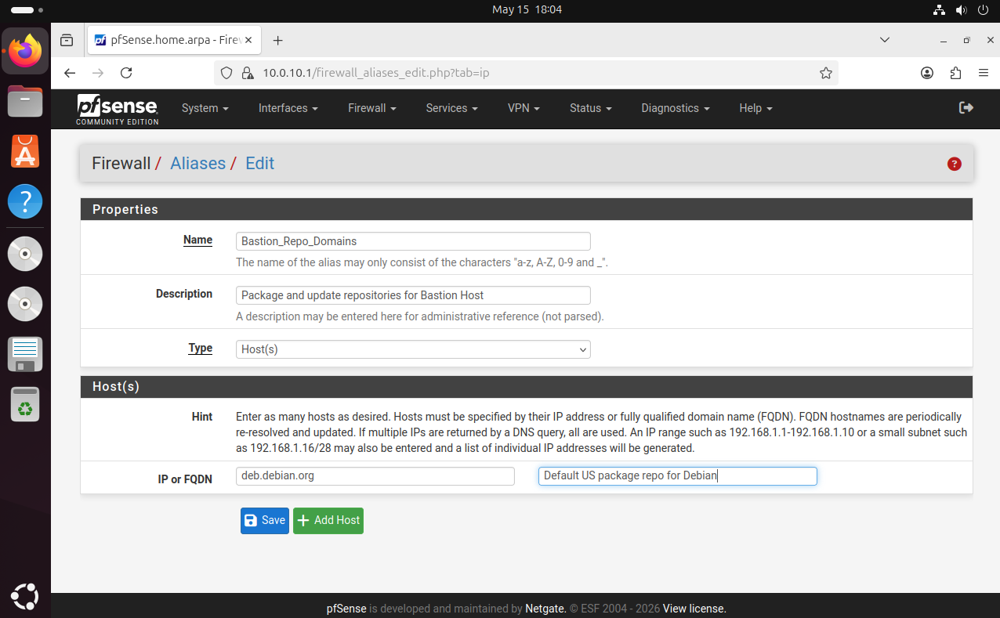

Guardar y aplicar los cambios.

### 2. Tomar snapshots

Antes de crear las reglas, tomar un snapshot del firewall y del bastion para poder volver atrás.

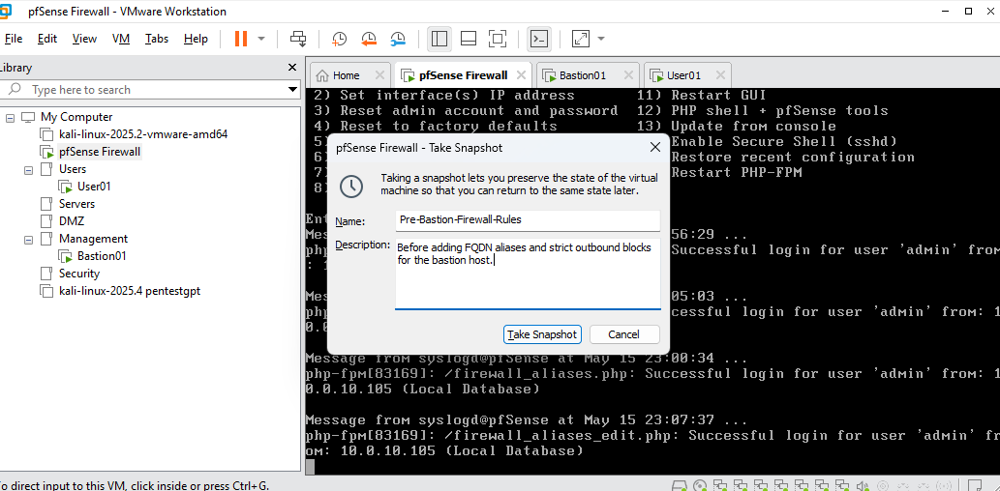

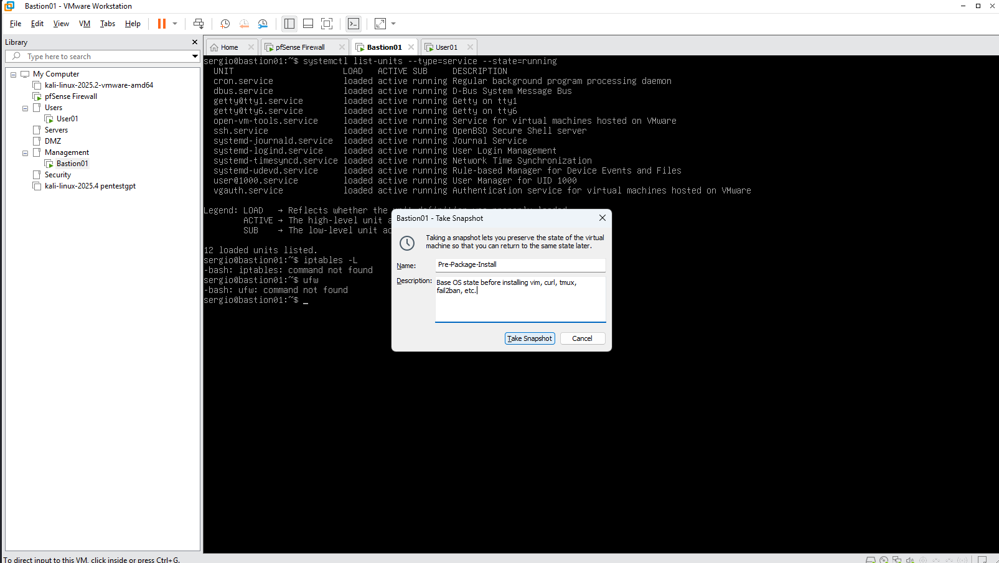

### 3. Crear las reglas de salida

En **Firewall → Rules → OPT3** (interfaz de Management):

| Acción | Protocolo | Origen | Destino | Puerto | Descripción |
| ------ | --------- | ------ | ------- | ------ | ----------- |
| Pass | TCP/UDP | `10.0.40.10` | any | 53 (DNS) | Allow DNS from Bastion Host |
| Pass | TCP | `10.0.40.10` | `Bastion_Repo_Domains` | 443 (HTTPS) | Allow Package Downloads (HTTPS) |
| Pass | TCP | `10.0.40.10` | `Bastion_Repo_Domains` | 80 (HTTP) | Allow Package Downloads (HTTP) |

> 💡 Para HTTP y HTTPS se pueden crear dos reglas separadas o un *Port Alias* con 80 y 443.

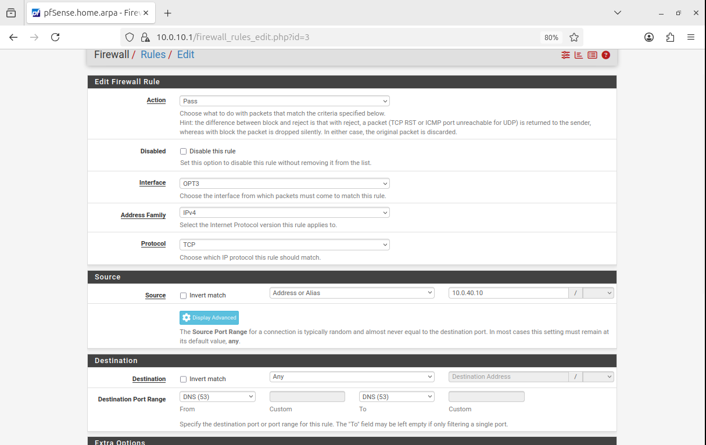

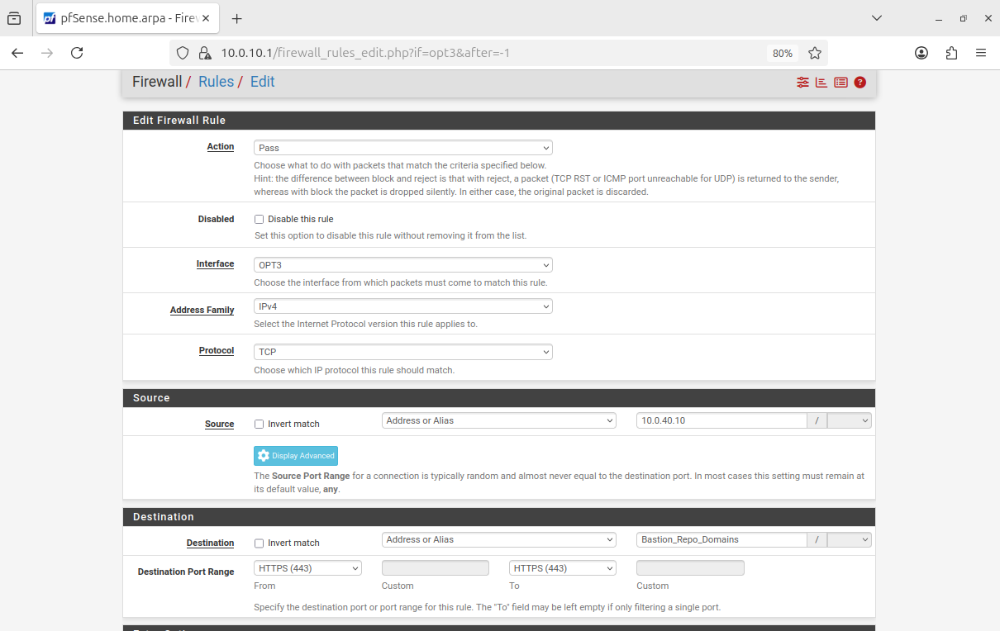

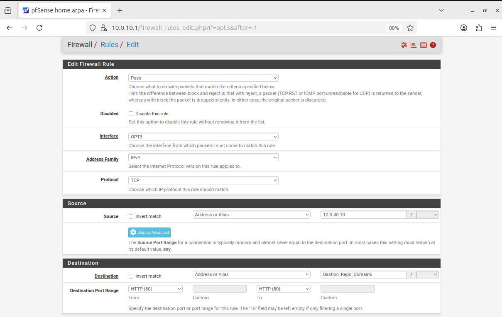

Aplicar los cambios. Resultado en OPT3 (incluye también una regla ICMP para hacer ping desde el bastion y la regla temporal de Internet ya deshabilitada):

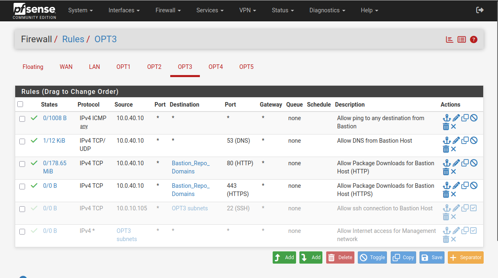

### 4. Verificar desde el bastion

```bash
sudo apt-get clean     # borra la caché de paquetes
sudo apt-get update    # debe funcionar si pfSense permite el tráfico
```

---

## Herramientas básicas

```bash
sudo apt install -y curl auditd fail2ban ufw libpam-google-authenticator \
  htop nmap tcpdump traceroute mtr-tiny
```

| Herramienta | Uso |
| ----------- | --- |
| `curl` | Probar conectividad HTTP/HTTPS y APIs |
| `auditd` | Auditoría del sistema Linux (`man auditd`) |
| `fail2ban` | Protección contra fuerza bruta |
| `ufw` | Firewall local |
| `libpam-google-authenticator` | MFA (TOTP) al iniciar sesión (`man google-authenticator`) |
| `htop` | Monitoreo interactivo de CPU, memoria y procesos |
| `nmap` | Descubrimiento y auditoría de red interna (no puede salir de la red) |
| `tcpdump` | Captura y análisis de tráfico en consola (similar a Wireshark) |
| `traceroute` / `mtr` | Diagnóstico de conectividad |

El agente de Wazuh se instala más adelante (ver [Wazuh](WazuhServer_Checho.md#instalar-agentes)).

---

## AppArmor

Debian 13 trae **AppArmor** activado por defecto. AppArmor restringe lo que puede hacer cada programa (qué archivos lee, a qué redes accede) mediante perfiles individuales. Si alguna herramienta falla sin razón aparente, conviene revisar si AppArmor la está bloqueando.

```bash
sudo aa-status | less     # perfiles cargados
```

- **Complain:** la aplicación funciona normalmente, pero las violaciones se registran en el log.
- **Enforce:** AppArmor bloquea activamente lo que el perfil no permite.

Para crear o modificar perfiles:

```bash
sudo apt install apparmor-utils apparmor-profiles
```

Los perfiles están en `/etc/apparmor.d/` y se nombran reemplazando las `/` de la ruta del ejecutable por `.`. Por ejemplo, el perfil de `/usr/bin/ping` es `/etc/apparmor.d/usr.bin.ping`.

**Reglas básicas**

| Regla | Significado |
| ----- | ----------- |
| `r` | Lectura |
| `w` | Escritura / modificación |
| `px` | Ejecutar el archivo bajo su propio perfil |
| `/**` | El directorio y todos sus subdirectorios |
| `network inet stream,` | Conexiones TCP (IPv4) |
| `network inet6 dgram,` | Conexiones UDP (IPv6) |

```text
/var/log/nginx/*.log w,      # permite escribir cualquier .log en esa ruta
/etc/nginx/** r,             # permite leer todo dentro de /etc/nginx/
```

**Forma recomendada: modo aprendizaje**

1. Poner el programa en modo *complain* y usarlo normalmente.
2. Ejecutar `sudo aa-logprof`: lee los logs y pregunta si permitir o denegar cada acción.
3. Recargar el perfil en el kernel:

   ```bash
   sudo apparmor_parser -r /etc/apparmor.d/nombre.del.perfil
   ```

4. Volver al modo estricto:

   ```bash
   sudo aa-enforce /ruta/al/programa
   ```

---

## Hardening: ufw, MFA, SSH y fail2ban

### 1. ufw

Permitir SSH desde la subred de Management y activar el firewall:

```bash
sudo ufw allow from 10.0.40.0/28
sudo ufw allow 22/tcp
sudo ufw enable
```

> 💡 `sudo ufw allow 22/tcp` permite SSH desde cualquier origen. Una vez probado el acceso con llave (más abajo), se puede restringir a la Admin VM con `sudo ufw allow from 10.0.40.11 to any port 22 proto tcp` y borrar las reglas genéricas (`sudo ufw status numbered` → `sudo ufw delete <n>`).

### 2. Google Authenticator (PAM MFA)

Con el usuario que va a iniciar sesión, ejecutar:

```bash
google-authenticator
```

Responder: **Y** a tokens basados en tiempo, **Y** a no permitir reutilizar el mismo token, **N** a ampliar la ventana de tiempo y **Y** al rate-limiting. Escanear el código QR con la app de autenticación.

Editar la configuración de PAM para SSH (PAM, *Pluggable Authentication Modules*, es el marco que centraliza la autenticación en Linux):

```bash
sudo nano /etc/pam.d/sshd
```

Agregar justo **debajo** de `@include common-auth`:

```text
auth required pam_google_authenticator.so nullok
```

- Se coloca después de `common-auth` para que primero se pida la contraseña y luego el código TOTP.
- `nullok` evita quedarse por fuera si un usuario aún no configuró MFA. **Quitarlo al terminar las pruebas.**

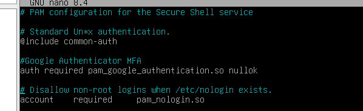

> ⚠️ En la captura el módulo aparece como `pam_google_authentication.so`. El nombre correcto del módulo es **`pam_google_authenticator.so`**.

### 3. Configuración de SSH (fase 1: contraseña + TOTP)

```bash
sudo nano /etc/ssh/sshd_config
```

```text
PermitRootLogin no

PubkeyAuthentication yes
PasswordAuthentication yes

KbdInteractiveAuthentication yes
ChallengeResponseAuthentication yes   # alias antiguo de KbdInteractiveAuthentication

UsePAM yes

AuthenticationMethods keyboard-interactive

X11Forwarding no
AllowAgentForwarding no
PermitTunnel no

MaxAuthTries 3
LoginGraceTime 30
```

Validar la sintaxis (si no imprime nada, está bien) y reiniciar:

```bash
sudo sshd -t
sudo systemctl restart ssh
```

### 4. fail2ban + ufw

> Recurso útil: <https://www.alcancelibre.org/manuales/configuracion-de-fail2ban>

```bash
sudo cp /etc/fail2ban/jail.conf /etc/fail2ban/jail.local
sudo nano /etc/fail2ban/jail.local
```

En la sección `[DEFAULT]`, configurar `ufw` como acción de bloqueo y agregar la red de Management a la lista blanca:

```ini
[DEFAULT]
ignoreip = 127.0.0.1/8 ::1 10.0.40.0/28
# Tiempo que una IP queda bloqueada
bantime  = 1h
# Ventana de tiempo para contar intentos fallidos
findtime = 10m
# Fallos permitidos antes del bloqueo
maxretry = 3
banaction = ufw
banaction_allports = ufw
# action_ = solo bloquear la IP (ya viene activo por defecto)
action = %(action_)s

[sshd]
enabled = true
port    = ssh
```

```bash
sudo systemctl enable fail2ban
sudo systemctl start fail2ban
```

Comandos útiles:

```bash
sudo fail2ban-client status sshd                    # estado de la jail
sudo fail2ban-client set sshd unbanip <IP_ADDRESS>  # desbloquear una IP
sudo tail -f /var/log/fail2ban.log                  # ver el log
```

> ⚠️ Con MFA, los intentos fallidos de TOTP generan mensajes distintos a los de contraseña incorrecta, así que el filtro `sshd` de fail2ban puede no detectarlos. Después de un intento fallido de MFA, revisar el log de autenticación y confirmar que el filtro coincide con el formato. En Debian 13 los logs de SSH van a journald por defecto: `sudo journalctl -u ssh` (o `/var/log/auth.log` si `rsyslog` está instalado).

### 5. Probar desde la Admin VM

Se crea una VM de administrador (`10.0.40.11`) que se conecta al bastion por SSH. Al conectarse debe pedir contraseña y código de Google Authenticator.

> Como la Admin VM está en la **misma subred** que el bastion, el tráfico SSH no pasa por pfSense: la conexión funciona aunque no exista una regla en el firewall.

---

## Autenticación con llave pública + MFA

### 1. Crear el par de llaves en la Admin VM

```bash
ssh-keygen -t ed25519 -a 100
```

Ed25519 es el algoritmo moderno de SSH: llaves más pequeñas, más rápido y con excelente seguridad. Aceptar la ruta por defecto y **usar una passphrase**.

### 2. Verificar las llaves

```bash
ls -l ~/.ssh
```

Los permisos deben verse así:

```text
-rw------- id_ed25519
-rw-r--r-- id_ed25519.pub
```

### 3. Copiar la llave pública al bastion

```bash
ssh-copy-id sergio@10.0.40.10
```

Pide la contraseña del usuario en el bastion y se encarga de crear `~/.ssh/authorized_keys` con los permisos correctos. En el bastion, verificar:

```bash
cat ~/.ssh/authorized_keys     # debe aparecer: ssh-ed25519 AAAAC3...
```

### 4. Exigir llave + MFA

En el bastion, editar `/etc/ssh/sshd_config` para que quede así:

```text
PermitRootLogin no

PubkeyAuthentication yes
PasswordAuthentication no

KbdInteractiveAuthentication yes
UsePAM yes

AuthenticationMethods publickey,keyboard-interactive
```

### 5. Reiniciar SSH

```bash
sudo sshd -t
sudo systemctl restart ssh
```

### 6. Probar la autenticación

**Sin cerrar la sesión actual**, abrir otra terminal en la Admin VM:

```bash
ssh sergio@10.0.40.10
```

Flujo esperado:

```text
SSH key accepted
      ↓
Verification code:
      ↓
TOTP accepted
      ↓
Login successful
```

Puede pedir primero la passphrase de la llave y luego el código de Google.

### 7. Confirmar qué llave se usa

```bash
ssh -v sergio@10.0.40.10
```

Si aparecen `Offering public key:` y `Server accepts key`, la llave se está usando correctamente.

### 8. Restringir SSH a la Admin VM

**En pfSense (OPT3):**

| Acción | Protocolo | Origen | Destino | Puerto |
| ------ | --------- | ------ | ------- | ------ |
| Pass | TCP | `10.0.40.11` | `10.0.40.10` | 22 |
| Block | TCP | OPT3 net | `10.0.40.10` | 22 |

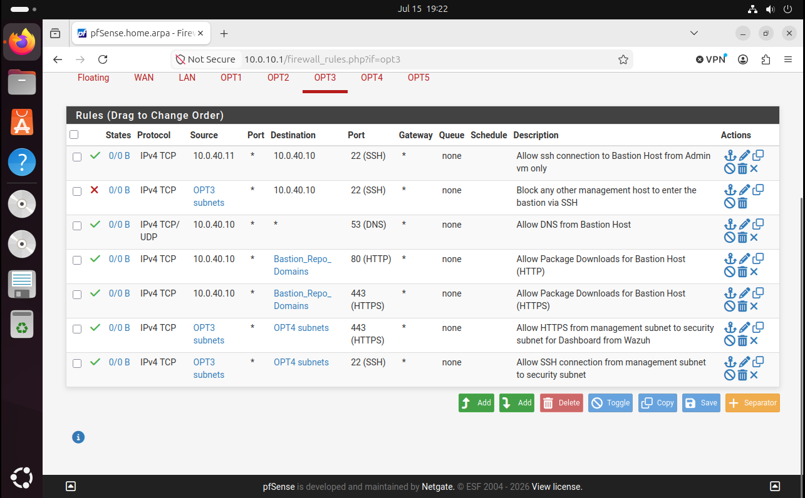

> ⚠️ Estas reglas solo filtran tráfico que **cruza** el firewall. Mientras la Admin VM y el bastion estén en la misma subred, el control efectivo está en el propio bastion (`ufw` y la restricción `from=` de abajo).

**En el bastion**, limitar desde dónde se acepta la llave:

```bash
nano ~/.ssh/authorized_keys
```

```text
ssh-ed25519 AAAA...
      ↓
from="10.0.40.11" ssh-ed25519 AAAA...
```

Así, aunque alguien robe la llave privada, solo podría usarla desde `10.0.40.11`.

> 🔐 La llave **privada** nunca debe estar en el bastion. En el bastion solo va la **pública**.

### 9. Endurecer fail2ban

Para detectar fuerza bruta incluso si la Admin VM está comprometida, quitar la subred de Management de la lista blanca en `/etc/fail2ban/jail.local`:

```ini
[DEFAULT]
ignoreip = 127.0.0.1/8 ::1
```

```bash
sudo systemctl restart fail2ban
```

---

## Mejoras futuras

- Mover la Admin VM a otra subred/VLAN para que todo el tráfico SSH cruce el firewall y pueda filtrarse, registrarse y monitorearse, como en una arquitectura empresarial.
- Agregar una VPN para el acceso administrativo remoto.

**Lecturas recomendadas**

- [SSH bastion hardening best practices – Teleport](https://goteleport.com/blog/security-hardening-ssh-bastion-best-practices/)
- [Weak Diffie-Hellman and the Logjam Attack](https://weakdh.org/)
- [CVE-2020-27347 – NVD](https://nvd.nist.gov/vuln/detail/CVE-2020-27347)
- Riesgos de permitir ICMP sin restricciones (pendiente: agregar una fuente concreta)

[⬅️ Anterior: Firewall pfSense](Firewall_Checho.md) · [Volver al README](README.md) · [Siguiente: Active Directory ➡️](ActiveDirectory_Checho.md)
