# 6. Despliegue de Sysmon

[⬅️ Anterior: GPOs de seguridad](SecurityBaselineGPOs_Checho.md) · [Volver al README](README.md) · [Siguiente: Wazuh ➡️](WazuhServer_Checho.md)

**Sysmon** (*System Monitor*, de Sysinternals) registra actividad detallada de Windows —creación de procesos, conexiones de red, consultas DNS, archivos creados, cambios en el registro— que luego se envía a Wazuh para crear detecciones.

Primero se instala manualmente en `ADDC01` y `WIN11-01`; después se automatiza para cualquier equipo nuevo mediante una GPO.

## Contenido

- [Descargas](#descargas)
- [Instalación manual](#instalación-manual)
- [Event IDs importantes](#event-ids-importantes)
- [Despliegue automático por Group Policy](#despliegue-automático-por-group-policy)

## Descargas

| Recurso | Enlace |
| ------- | ------ |
| Sysmon | <https://learn.microsoft.com/es-es/sysinternals/downloads/sysmon> |
| Configuración usada: SwiftOnSecurity | <https://github.com/SwiftOnSecurity/sysmon-config> |
| Alternativa: sysmon-modular (Olaf Hartong) | <https://github.com/olafhartong/sysmon-modular> |

Ambas configuraciones aparecen recomendadas en la [documentación de Microsoft](https://learn.microsoft.com/es-es/windows/security/operating-system-security/sysmon/how-to-enable-sysmon).

Sysmon se descarga como un `.zip` con `Sysmon.exe`, `Sysmon64.exe`, `Sysmon64a.exe` y `Eula.txt`. La configuración de SwiftOnSecurity es un único archivo `sysmonconfig-export.xml`.

---

## Instalación manual

### 1. Preparar la carpeta

Crear `C:\Sysmon` y copiar ahí `Sysmon64.exe` y `sysmonconfig-export.xml`.

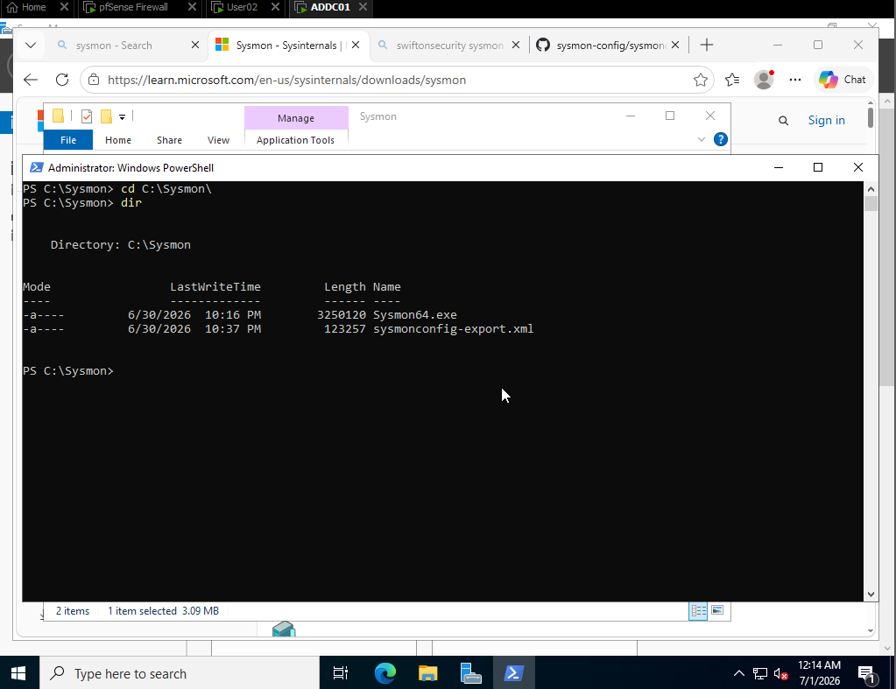

### 2. Instalar

En PowerShell como administrador:

```powershell
cd C:\Sysmon
.\Sysmon64.exe -accepteula -i .\sysmonconfig-export.xml
```

Salida esperada:

```text
Configuration file validated.
Sysmon64 installed.
SysmonDrv installed.
Starting SysmonDrv.
SysmonDrv started.
Starting Sysmon64..
Sysmon64 started.
```

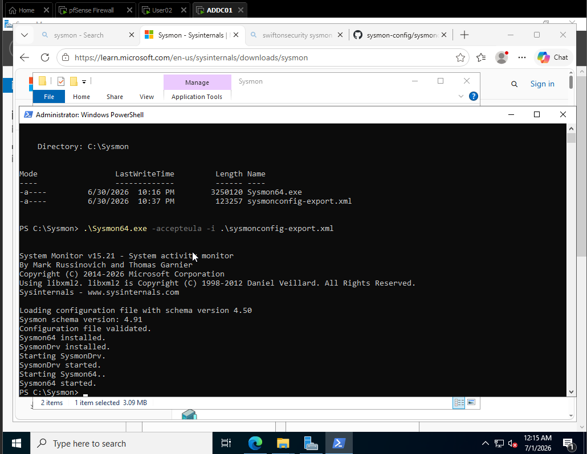

### 3. Verificar el servicio y la configuración

```powershell
Get-Service Sysmon64      # Status: Running
.\Sysmon64.exe -c         # muestra la configuración activa
```

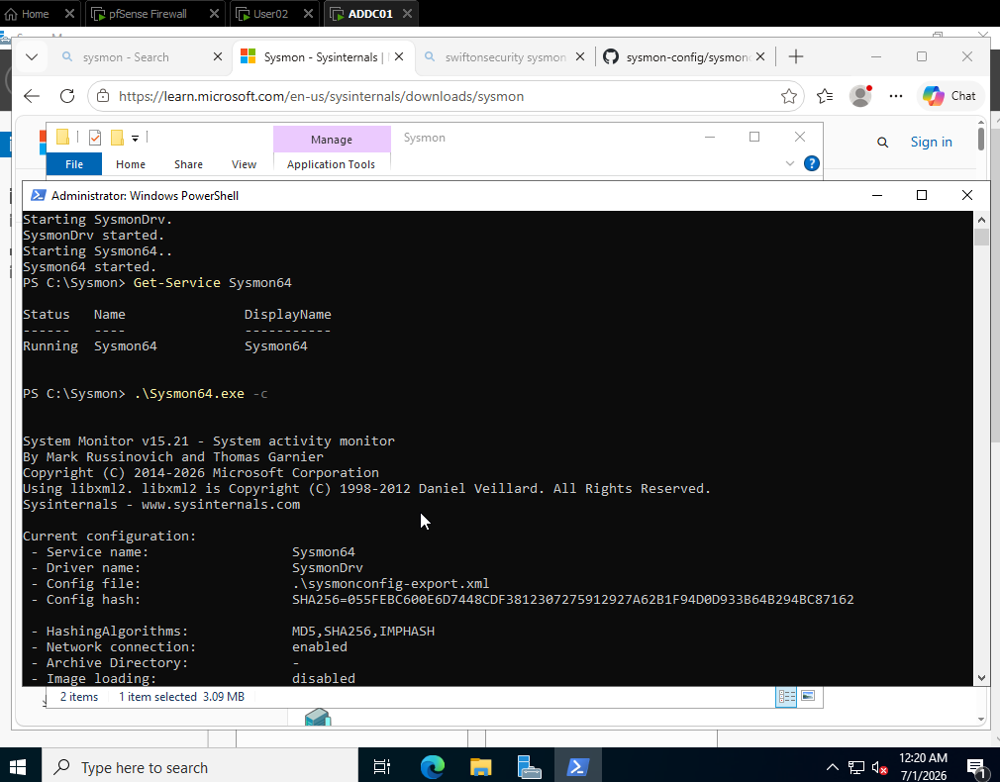

### 4. Verificar que se generan logs

- **Event Viewer → Applications and Services Logs → Microsoft → Windows → Sysmon → Operational**, o
- PowerShell:

  ```powershell
  Get-WinEvent -LogName "Microsoft-Windows-Sysmon/Operational" -MaxEvents 10
  ```

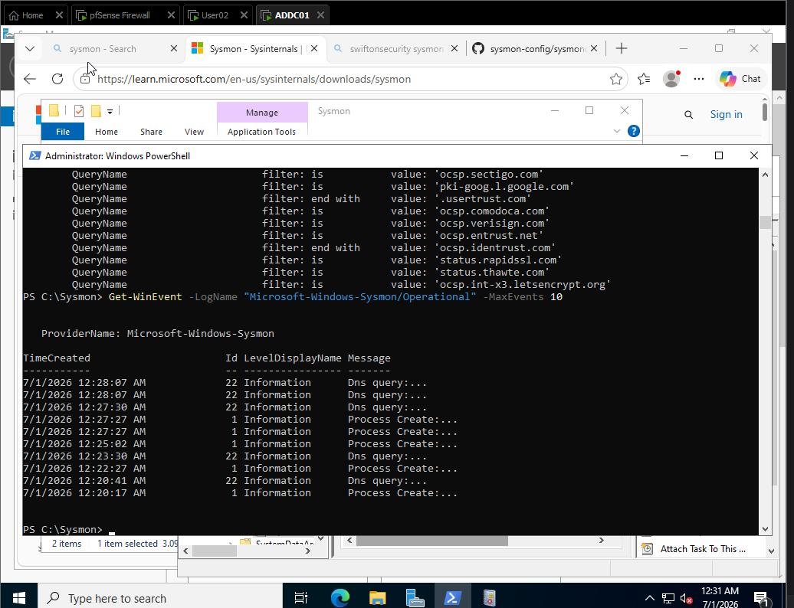

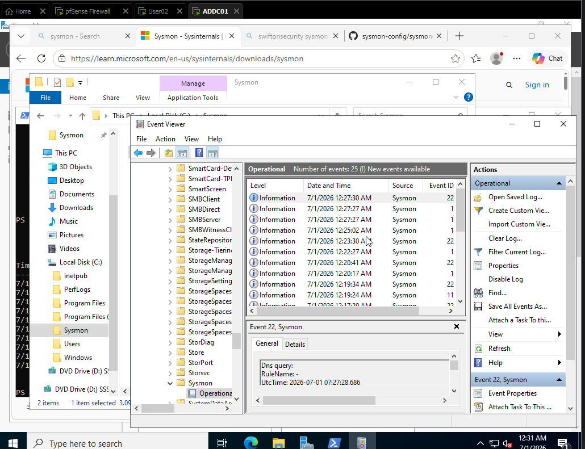

### 5. Generar eventos de prueba

```powershell
notepad.exe
Get-Date
ping 8.8.8.8

Get-WinEvent -LogName "Microsoft-Windows-Sysmon/Operational" -MaxEvents 20 |
  Select-Object Id, TimeCreated, Message
```

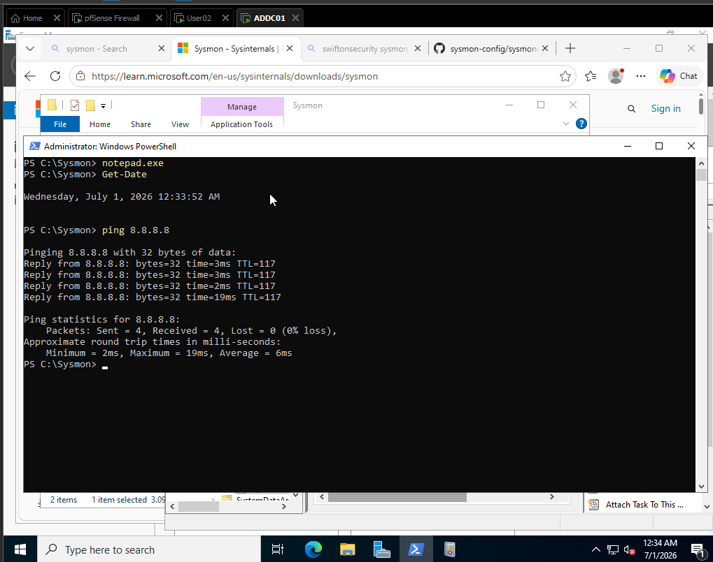

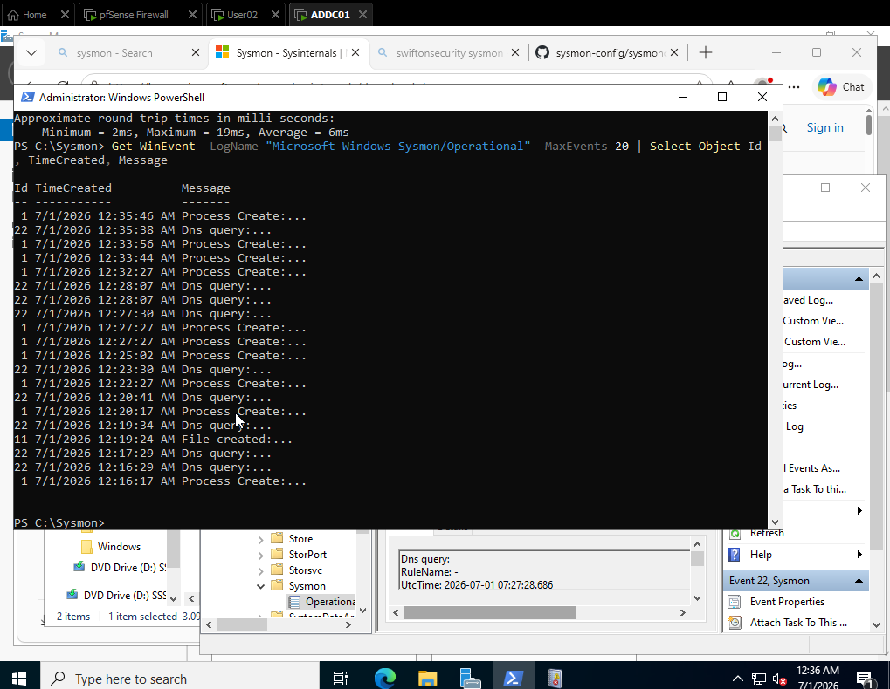

Repetir el mismo proceso en `WIN11-01`:

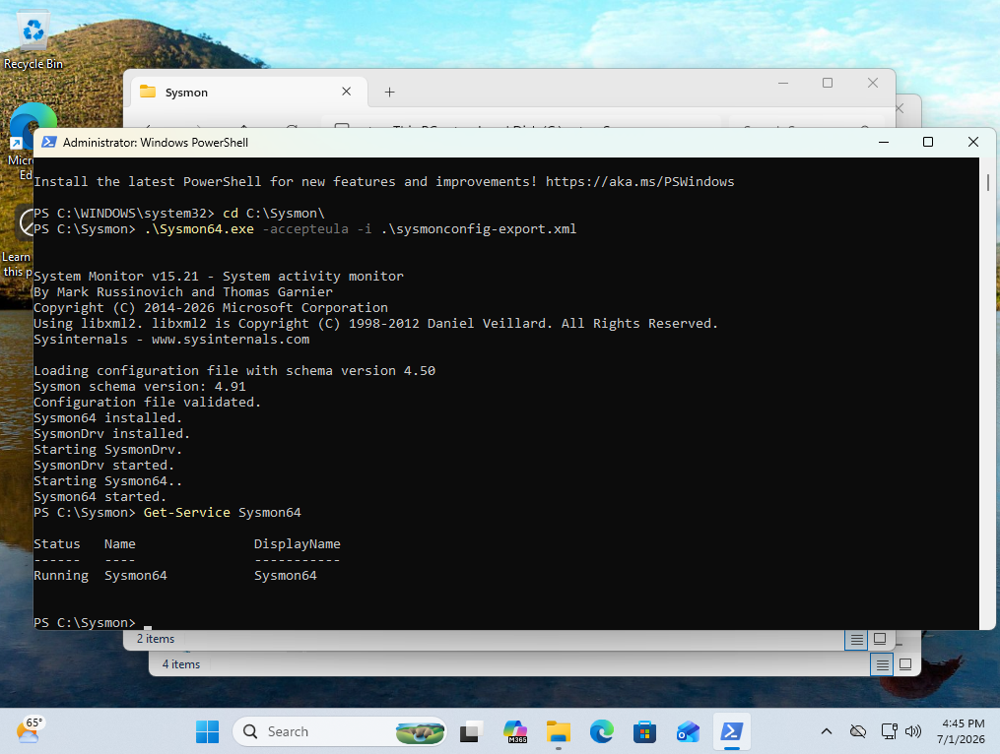

---

## Event IDs importantes

Se usan constantemente al crear detecciones en Wazuh:

| Event ID | Descripción | Por qué importa |
| -------- | ----------- | --------------- |
| 1 | Process Creation | Ejecución de malware, PowerShell, LOLBins |
| 3 | Network Connection | Conexiones salientes sospechosas y C2 |
| 5 | Process Terminated | Análisis del ciclo de vida de procesos |
| 7 | Image Loaded | Inyección de DLL y módulos sospechosos |
| 8 | CreateRemoteThread | Técnicas de inyección de código |
| 10 | Process Access | Robo de credenciales (p. ej. acceso a LSASS) |
| 11 | File Create | Malware que deja archivos en disco |
| 12–14 | Registry Events | Mecanismos de persistencia |
| 22 | DNS Query | Dominios consultados por cada proceso |

---

## Despliegue automático por Group Policy

La idea es simular cómo las empresas instalan Sysmon automáticamente en cada equipo nuevo que entra al dominio:

```text
ADDC01
│
├── SYSVOL
│   └── scripts\Sysmon
│       ├── Sysmon64.exe
│       ├── sysmonconfig-export.xml
│       └── install_sysmon.cmd
│
└── GPO "Workstation Baseline"
      │
      └── Startup Script ──► se ejecuta al arrancar cada equipo de la OU Workstations
```

Pasos:

1. [Crear la carpeta compartida en SYSVOL](#1-crear-la-carpeta-en-sysvol)
2. [Crear el script de instalación](#2-crear-el-script-de-instalación)
3. [Agregar el script a la GPO Workstation Baseline](#3-agregar-el-script-a-la-gpo)
4. [Actualizar Group Policy](#4-actualizar-group-policy)
5. [Verificar la instalación](#5-verificar-la-instalación)
6. [Probar con una workstation nueva](#6-probar-con-una-workstation-nueva)

### 1. Crear la carpeta en SYSVOL

En `ADDC01`, crear la carpeta `Sysmon` en:

```text
C:\Windows\SYSVOL\sysvol\corp.lab\scripts\
```

y copiar ahí `Sysmon64.exe` y `sysmonconfig-export.xml`.

Se usa SYSVOL porque, por defecto, todos los equipos del dominio pueden leerlo.

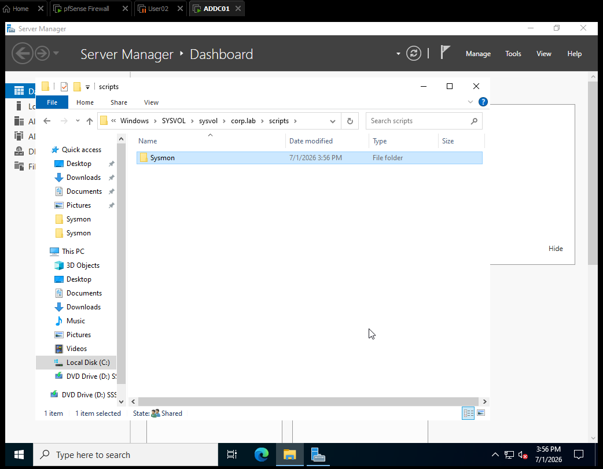

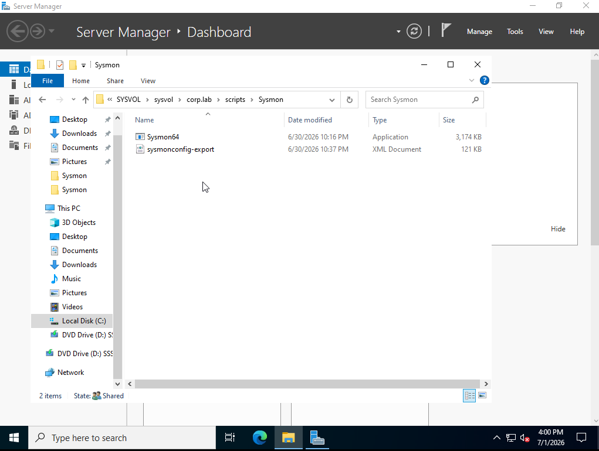

### 2. Crear el script de instalación

Crear con el Bloc de notas un archivo `install_sysmon.cmd` (la extensión **debe** ser `.cmd`) **en la misma carpeta** `scripts\Sysmon`. `%~dp0` se expande a la carpeta donde está el script, por eso el `.exe` y el `.xml` deben estar junto a él.

**Versión básica:** instala Sysmon solo si no está instalado.

```bat
@echo off

if exist "C:\Windows\Sysmon64.exe" (
    echo Sysmon already installed.
    exit /b
)

copy "%~dp0Sysmon64.exe" "C:\Windows\Sysmon64.exe"

"C:\Windows\Sysmon64.exe" -accepteula -i "%~dp0sysmonconfig-export.xml"
```

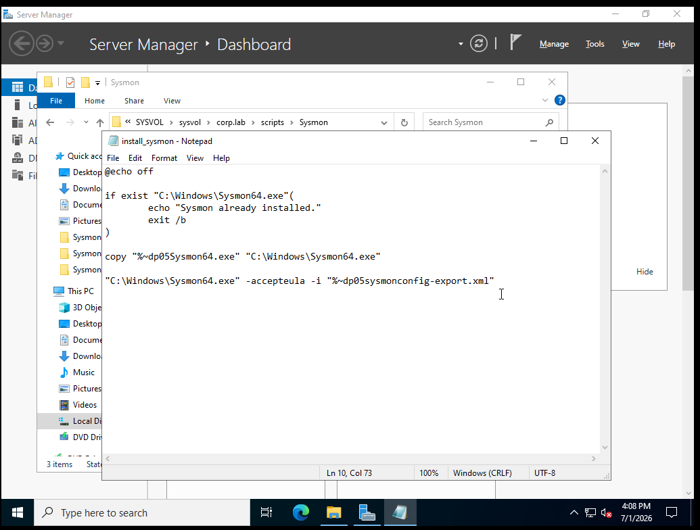

**Versión que también actualiza la configuración** si Sysmon ya está instalado:

```bat
@echo off

if exist "C:\Windows\Sysmon64.exe" (
    "C:\Windows\Sysmon64.exe" -c "%~dp0sysmonconfig-export.xml"
) else (
    copy "%~dp0Sysmon64.exe" "C:\Windows\Sysmon64.exe" /Y
    "C:\Windows\Sysmon64.exe" -accepteula -i "%~dp0sysmonconfig-export.xml"
)
```

**Versión mejorada** (la usada en el laboratorio):

```bat
@echo off
setlocal

:: Definir rutas para mantener el código limpio
set "ORIGEN_EXE=%~dp0Sysmon64.exe"
set "ORIGEN_XML=%~dp0sysmonconfig-export.xml"
set "DESTINO_EXE=C:\Windows\Sysmon64.exe"

:: 1. Comprobar si Sysmon ya existe en el sistema
if exist "%DESTINO_EXE%" (
    echo [INFO] Sysmon detectado. Actualizando ejecutable y configuracion...
    copy "%ORIGEN_EXE%" "%DESTINO_EXE%" /Y
    "%DESTINO_EXE%" -c "%ORIGEN_XML%"
) else (
    echo [INFO] Sysmon no detectado. Iniciando instalacion limpia...
    copy "%ORIGEN_EXE%" "%DESTINO_EXE%" /Y
    "%DESTINO_EXE%" -accepteula -i "%ORIGEN_XML%"
)

endlocal
```

Mejoras de esta versión:

1. **Variables:** las rutas se definen una sola vez al inicio, así el código es más corto y fácil de modificar.
2. **Mensajes (`echo`):** indican qué camino tomó el script.
3. **`setlocal` / `endlocal`:** las variables no afectan a otras ventanas de CMD.

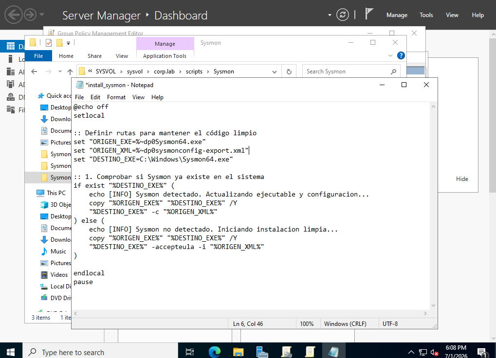

> ⚠️ **No usar `pause` en un script de inicio.** Los scripts de inicio de GPO se ejecutan sin ventana visible: un `pause` deja el script esperando una tecla que nadie va a presionar y retrasa el arranque hasta que se agota el tiempo de espera. Úsalo solo al probar el script manualmente.
>
> 💡 `copy ... /Y` sobre `C:\Windows\Sysmon64.exe` puede fallar si el servicio está en ejecución (el archivo está en uso). Para actualizar la **versión** de Sysmon hay que desinstalar (`Sysmon64.exe -u`) y reinstalar; para cambiar solo la **configuración** basta con `-c`.

### 3. Agregar el script a la GPO

1. En **Group Policy Management**, editar la GPO `Workstation Baseline`.
2. Ir a **Computer Configuration → Policies → Windows Settings → Scripts (Startup/Shutdown) → Startup** y hacer doble clic.
3. Clic en **Add...** → **Browse...**

   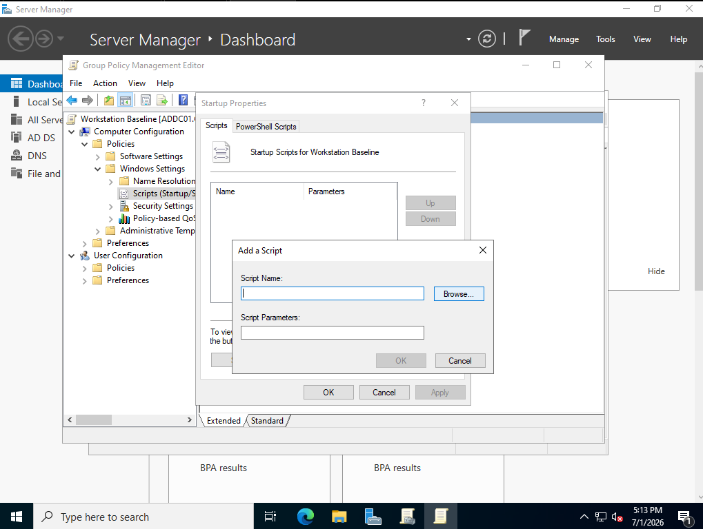

4. Seleccionar el script de la carpeta de SYSVOL. La ruta debe quedar así:

   ```text
   \\corp.lab\SYSVOL\corp.lab\scripts\Sysmon\install_sysmon.cmd
   ```

   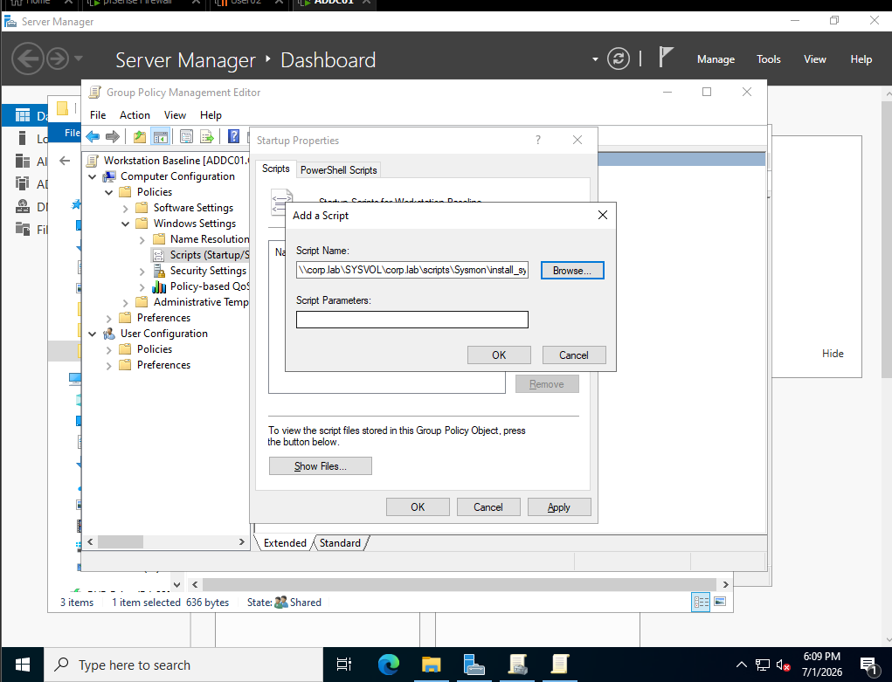

> 💡 El botón **Show Files** abre la carpeta de scripts propia de la GPO (`...\Machine\Scripts\Startup`). No hace falta copiar el script ahí: si se ejecutara desde esa carpeta, `%~dp0` apuntaría a ella y no encontraría `Sysmon64.exe` ni el `.xml`. Lo importante es que la ruta configurada sea la de `scripts\Sysmon`.
>
> 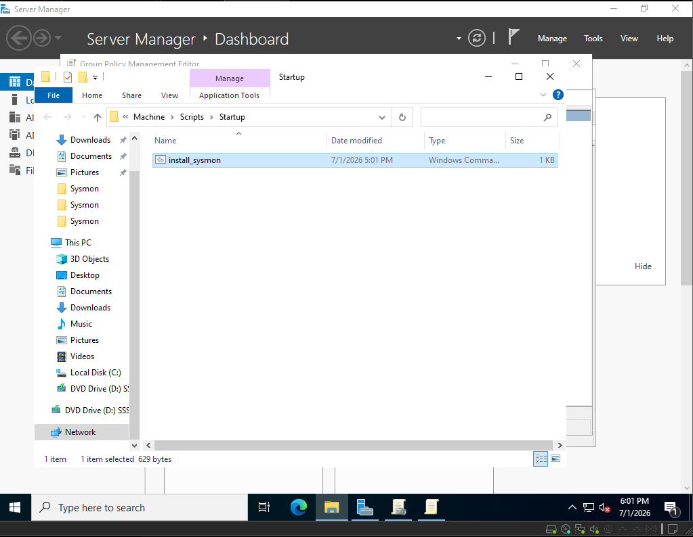

### 4. Actualizar Group Policy

En `WIN11-01`:

```cmd
gpupdate /force
shutdown /r /t 0
```

Los scripts de inicio se ejecutan al arrancar, por eso es necesario reiniciar.

### 5. Verificar la instalación

```powershell
Get-Service Sysmon64          # Status: Running
Get-WinEvent -LogName "Microsoft-Windows-Sysmon/Operational" -MaxEvents 10
```

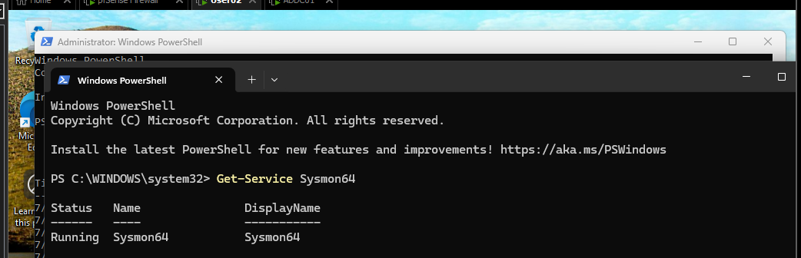

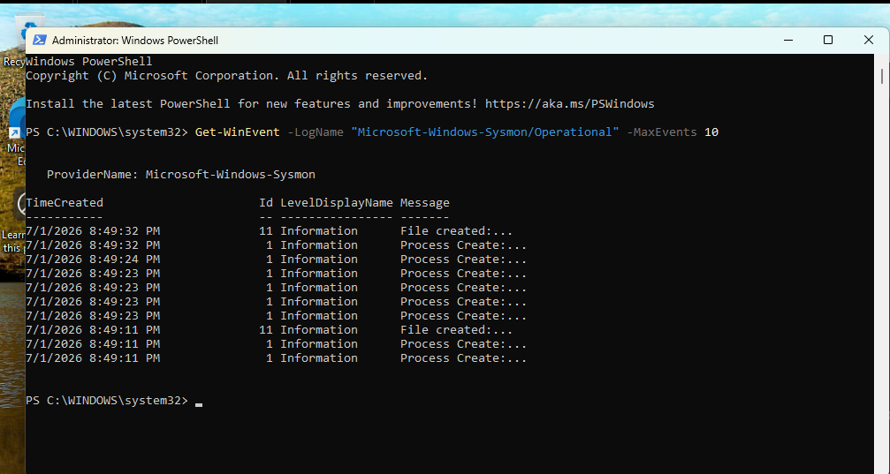

### 6. Probar con una workstation nueva

1. Montar otra workstation (`WIN11-02`) y unirla al dominio.
2. Moverla de `Computers` a la OU `Workstations`.

   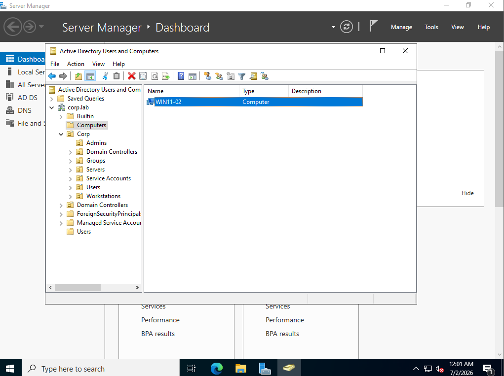

   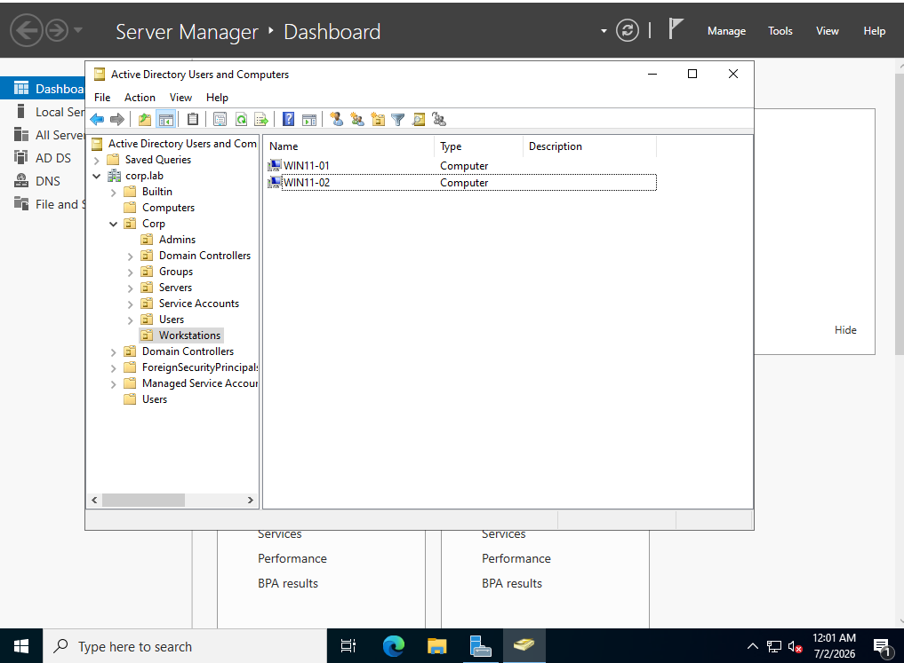

3. Reiniciarla.
4. Verificar como en el paso anterior.

   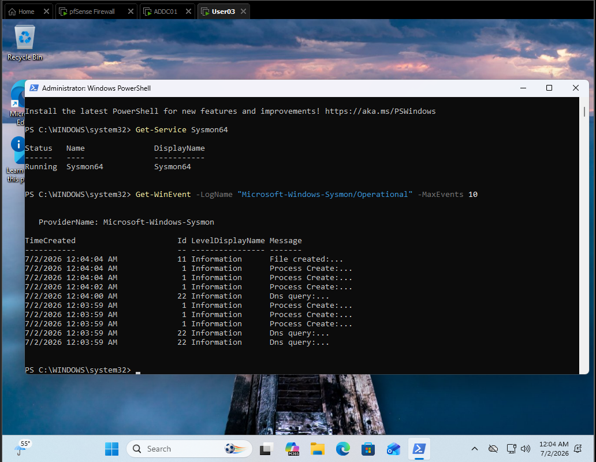

✅ El script de inicio instala Sysmon automáticamente, sin iniciar sesión ni copiar archivos a mano.

---

## Siguientes pasos

- [Montar Wazuh e instalar los agentes](WazuhServer_Checho.md)
- Verificar la telemetría
- Endurecer más el DC
- Montar la VM de ataque y generar detecciones
- Integrar Linux con AD
- Agregar AD CS

[⬅️ Anterior: GPOs de seguridad](SecurityBaselineGPOs_Checho.md) · [Volver al README](README.md) · [Siguiente: Wazuh ➡️](WazuhServer_Checho.md)
