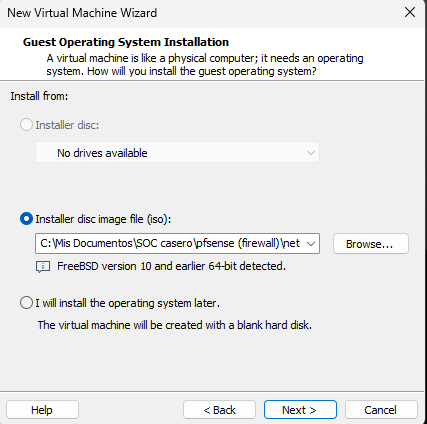
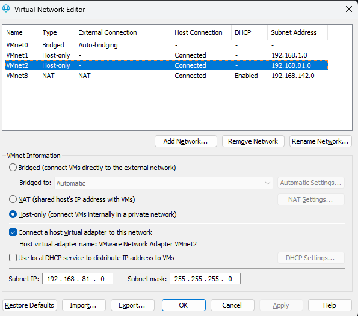
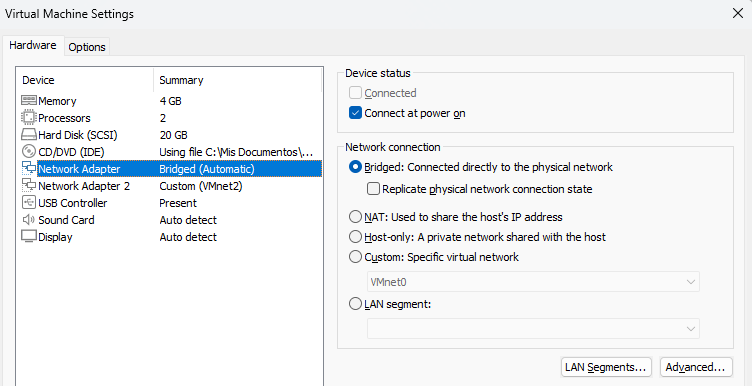
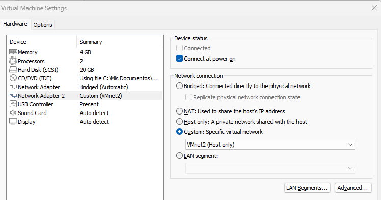
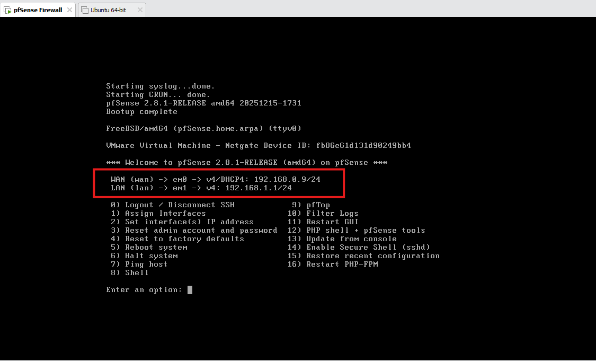
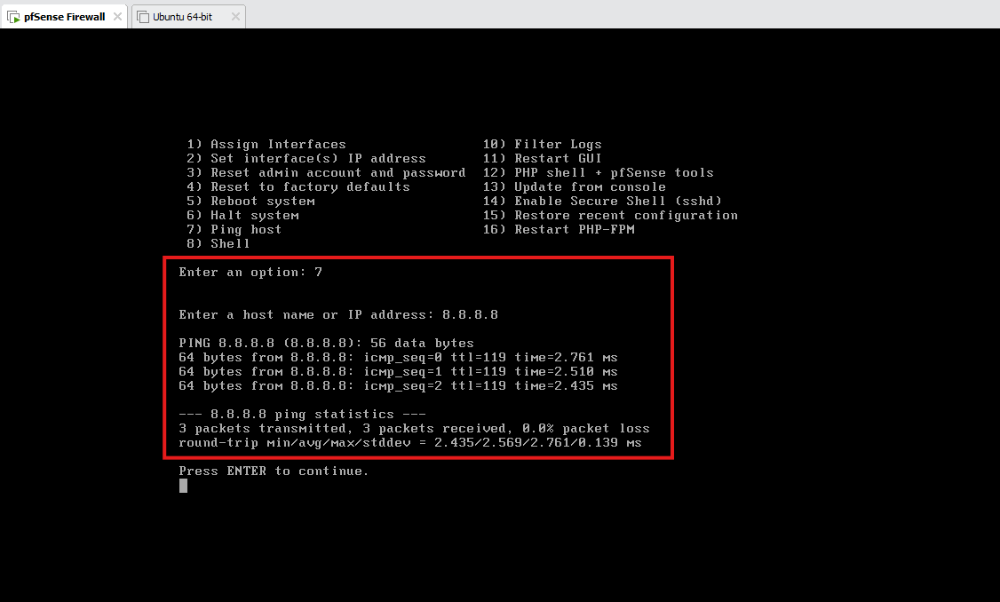

# 1. Firewall pfSense

[⬅️ Volver al README](README.md) · [Siguiente: Bastion Host ➡️](DebianBastionHost_Checho.md)

pfSense es el punto central del laboratorio: separa todas las subredes y decide qué tráfico pasa entre ellas y hacia Internet. Esta guía cubre la instalación en VMware Workstation y la configuración inicial de las interfaces WAN y LAN.

> 🎥 Video guía de referencia: <https://www.youtube.com/watch?v=p09ggIHt2j4>

## Requisitos

| Recurso | Valor |
| ------- | ----- |
| Hipervisor | VMware Workstation |
| ISO | pfSense Community Edition (<https://www.pfsense.org/download/>) |
| vCPU | 2 (mínimo) |
| RAM | 4 GB |
| Adaptadores de red | 2 (WAN + LAN) |

---

## Instalación

### 1. Descargar la ISO

Descargar la imagen ISO desde <https://www.pfsense.org/download/>.

### 2. Crear la máquina virtual

Crear una nueva VM en VMware usando la ISO de pfSense.



### 3. Crear la red interna en el Virtual Network Editor

Abrir el **Virtual Network Editor** como administrador y crear una red nueva:

- Tipo: **Host-only**.
- **DHCP desactivado**, para que las direcciones las asigne el firewall y no VMware.



### 4. Configurar los adaptadores de red de la VM

Antes de encender la VM, agregar un segundo adaptador de red y asignar 2 procesadores y 4 GB de RAM.

- **Adaptador 1 (WAN):** tipo de conexión **Bridged**.

  

- **Adaptador 2 (LAN):** tipo de conexión **Custom**, seleccionando la red virtual creada en el paso 3 (en este caso **VMnet2**).

  

### 5. Instalar pfSense

Encender la VM y seguir el instalador. Al asignar interfaces, verificar que:

- La interfaz conectada a **VMnet0** (Bridged) quede como **WAN**.
- La interfaz conectada a **VMnet2** quede como **LAN**.

### 6. Validar la asignación de interfaces

Al terminar, la consola muestra las IP asignadas a cada interfaz:



### 7. Probar la conexión a Internet

Desde la consola de pfSense (opción `7) Ping host`) o desde la shell:

```sh
ping 8.8.8.8
```



---

## Solución de problemas: VMs sin conectividad hasta reiniciar el firewall

**Síntoma:** las máquinas virtuales conectadas al firewall perdían conectividad y solo se recuperaban al reiniciar pfSense.

**Solución:** cambiar el tipo de adaptador virtual de las interfaces a `vmxnet3`, que tiene mejor soporte en FreeBSD.

1. Apagar la VM de pfSense.
2. Abrir con un editor de texto el archivo de configuración de la VM (en este caso `pfSense Firewall.vmx`), ubicado en la carpeta donde está guardada la VM.
3. Buscar todas las líneas con esta forma:

   ```ini
   ethernet0.virtualDev = "e1000"
   ```

   (también pueden aparecer como `"vlance"`) y cambiar el valor por:

   ```ini
   ethernet0.virtualDev = "vmxnet3"
   ```

   Repetir para `ethernet1`, `ethernet2`, etc.
4. Guardar y cerrar el archivo.
5. Encender la VM y **reasignar las interfaces** desde la consola (opción `1) Assign Interfaces`), ya que cambian de nombre: de `em0`/`le0` pasan a `vmx0`, `vmx1`, etc.

---

## Pendiente por documentar

- Creación de las interfaces adicionales (OPT1–OPT5) y asignación de sus IP para cada subred del laboratorio (ver la tabla de direccionamiento en el [README](README.md#direccionamiento)).
- Acceso a la interfaz web de pfSense y cambio de la contraseña por defecto del usuario `admin`.

[⬅️ Volver al README](README.md) · [Siguiente: Bastion Host ➡️](DebianBastionHost_Checho.md)
