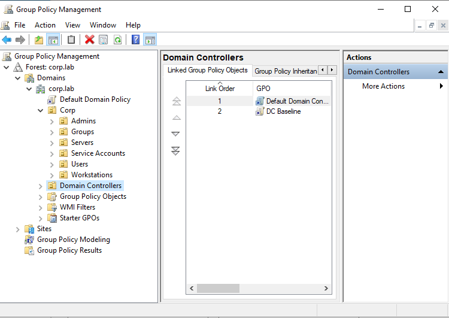

# 5. Security GPOs (Security Baselines)

[⬅️ Previous: Windows 11 Workstation](Win11_User_Checho.md) · [Back to README](README.md) · [Next: Sysmon ➡️](Deploy_Sysmon_Checho.md)

A **GPO** (*Group Policy Object*) lets administrators centrally manage operating system, application and security settings for many users and computers in the domain.

This lab creates two **detection-focused** baselines:

| GPO | Linked to | Goal |
| --- | --------- | ---- |
| **Workstation Baseline** | `Corp → Workstations` OU | Disable LLMNR and generate telemetry on user machines |
| **DC Baseline** | `Domain Controllers` OU | Same as above, plus Active Directory–specific auditing |

## Contents

- [Workstation Baseline](#workstation-baseline)
  - [1. Disable LLMNR](#1-disable-llmnr)
  - [2. PowerShell logging](#2-powershell-logging)
  - [3. Audit policies](#3-audit-policies)
- [DC Baseline](#dc-baseline)
- [Apply and verify](#apply-and-verify)

---

## Workstation Baseline

1. **Server Manager → Tools → Group Policy Management**.
2. Go to **Domains → corp.lab → Corp → Workstations**.
3. Right-click the OU → **Create a GPO in this domain, and Link it here...** → name: `Workstation Baseline`.

   

4. Right-click the GPO → **Edit**.

### 1. Disable LLMNR

**Computer Configuration → Policies → Administrative Templates → Network → DNS Client** → **Turn off multicast name resolution** → **Enabled**.


> **Why disable LLMNR?** When DNS fails, Windows asks the whole local network for the name via multicast using LLMNR (*Link-Local Multicast Name Resolution*). An attacker on the same network can answer, pretending to be the requested server (**LLMNR poisoning**, e.g. with *Responder*), trick the victim into authenticating against them, and capture the NetNTLMv2 hash (**credential theft**). That hash can be cracked or relayed to other servers (**relay attacks**) without ever knowing the password.

### 2. PowerShell logging

**Computer Configuration → Policies → Administrative Templates → Windows Components → Windows PowerShell**


- **Turn on Module Logging** → **Enabled**. Under *Module Names → Show...*, enter `*` to log every module.

  

  

- **Turn on PowerShell Script Block Logging** → **Enabled**.

  

### 3. Audit policies

**Computer Configuration → Policies → Windows Settings → Security Settings → Advanced Audit Policy Configuration → Audit Policies**


For every subcategory in the table, check **Configure the following audit events** with **Success** and **Failure**:


| Category | Subcategories | What it shows |
| -------- | ------------- | ------------- |
| **Logon/Logoff** | Audit Logon · Audit Logoff · Audit Special Logon · Audit Other Logon/Logoff Events | Successful and failed logins, RDP, administrator logins |
| **Account Logon** | Audit Credential Validation · Audit Kerberos Authentication Service · Audit Kerberos Service Ticket Operations · Audit Other Account Logon Events | AD authentication monitoring |
| **Account Management** | Audit User Account Management · Audit Security Group Management · Audit Computer Account Management · Audit Distribution Group Management · Audit Other Account Management Events | New or deleted users, password resets, users added to Domain Admins |
| **Detailed Tracking** | Audit Process Creation | Process creation (Event ID 4688) |
| **Policy Change** | Audit Audit Policy Change · Audit Authentication Policy Change · Audit Authorization Policy Change | Tampering with security settings |
| **Privilege Use** | Audit Sensitive Privilege Use | Abuse of powerful privileges |
| **Object Access** (minimal) | Audit File Share · Audit Detailed File Share | Access to file shares (useful once there are file servers) |


#### Include the command line in process creation events

**Computer Configuration → Policies → Administrative Templates → System → Audit Process Creation** → **Include command line in process creation events** → **Enabled**.

This makes Event ID 4688 include the arguments (e.g. `powershell.exe -enc ...` instead of just `powershell.exe`).


> ⚠️ With this setting, anyone who can read the security log will see command arguments, which sometimes contain sensitive data.

#### Avoid for now

These subcategories generate a very high volume of logs; it's better to introduce them later, in a controlled way:

- Audit File System
- Audit Registry
- Audit Kernel Object
- Audit Handle Manipulation
- Audit Removable Storage
- Audit Filtering Platform Packet Drop
- Audit Filtering Platform Connection

---

## DC Baseline

The domain controller uses the **Domain Controllers** OU that Windows creates by default at the root of `corp.lab`.

1. **Tools → Group Policy Management → Forest → Domains → corp.lab → Domain Controllers**.
2. Right-click → **Create a GPO in this domain, and Link it here...** → name: `DC Baseline`.

   The GPO is linked to the `Domain Controllers` OU at the **domain root** (where the `ADDC01` object lives), alongside the `Default Domain Controllers Policy`:

   

   > 💡 Linking it to the default OU is the right call: Microsoft doesn't recommend moving domain controllers out of it. If it were linked to another OU with the same name (e.g. inside `Corp`) that doesn't contain the DC, the policy would never apply.

3. Right-click → **Edit** and configure:

| # | Setting | Details |
| - | ------- | ------- |
| 1 | Disable LLMNR | Same as in the [Workstation Baseline](#1-disable-llmnr) |
| 2 | DC-specific auditing | The same policies as the Workstation Baseline, plus the ones below |
| 3 | PowerShell logging | Same as in the [Workstation Baseline](#2-powershell-logging) |
| 4 | Command line in process events | **Administrative Templates → System → Audit Process Creation → Include command line in process creation events** |

**Additional auditing for the DC** (Success and Failure):

| Category | Subcategory |
| -------- | ----------- |
| DS Access | Directory Service Changes |
| DS Access | Directory Service Access |
| Account Management | User Account Management |
| Account Management | Security Group Management |

---

## Apply and verify

### Force a policy update

On **ADDC01** (PowerShell as administrator) and on **WIN11-01**:

```powershell
gpupdate /force
```

Expected result: `Computer Policy update has completed successfully.`


### Confirm which GPOs were applied

```powershell
gpresult /scope computer /r
```

| Computer | Expected *Applied Group Policy Objects* |
| -------- | --------------------------------------- |
| WIN11-01 | `Workstation Baseline`, `Default Domain Policy` |
| ADDC01 | `DC Baseline`, `Default Domain Controllers Policy` |

### Spot checks

**LLMNR disabled**

```powershell
Get-ItemProperty "HKLM:\SOFTWARE\Policies\Microsoft\Windows NT\DNSClient"
```

Look for `EnableMulticast : 0`.

**PowerShell logging**

```powershell
Get-Process
Get-WinEvent -LogName "Microsoft-Windows-PowerShell/Operational" -MaxEvents 20
```

If events show up, Module Logging / Script Block Logging is working.

**Process creation auditing**

```cmd
notepad.exe
```

```powershell
Get-WinEvent -FilterHashtable @{LogName='Security'; Id=4688} -MaxEvents 10
```

If Event ID 4688 shows up, process auditing is working.

---

## Next steps

- 📸 Snapshot pfSense, ADDC01, WIN11-01 and Bastion01: **"VM__Pre_Sysmon_Wazuh"**
- [Deploy Sysmon](Deploy_Sysmon_Checho.md)
- [Build Wazuh and install the agents](WazuhServer_Checho.md)
- Verify telemetry
- Harden the DC further
- Build the attacker VM and generate detections
- Integrate Linux with AD
- Add AD CS

[⬅️ Previous: Windows 11 Workstation](Win11_User_Checho.md) · [Back to README](README.md) · [Next: Sysmon ➡️](Deploy_Sysmon_Checho.md)
