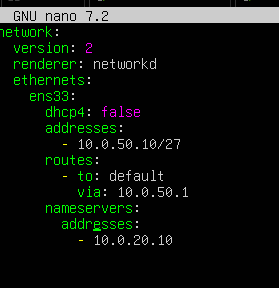
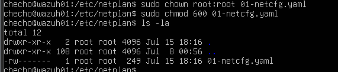
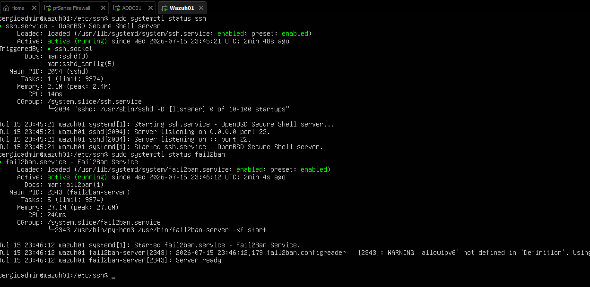
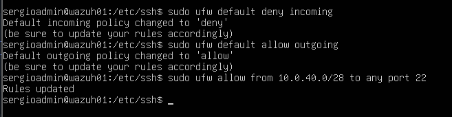
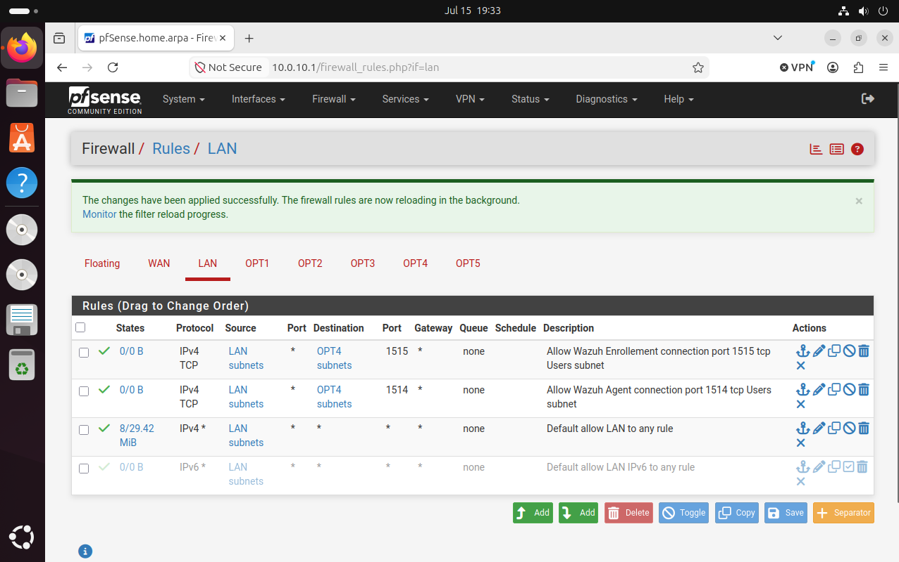
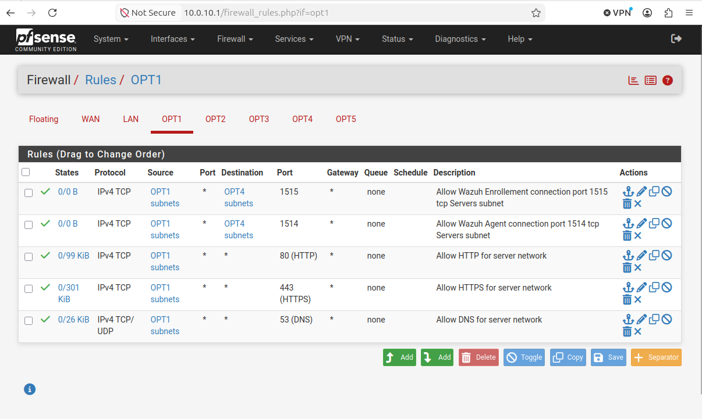
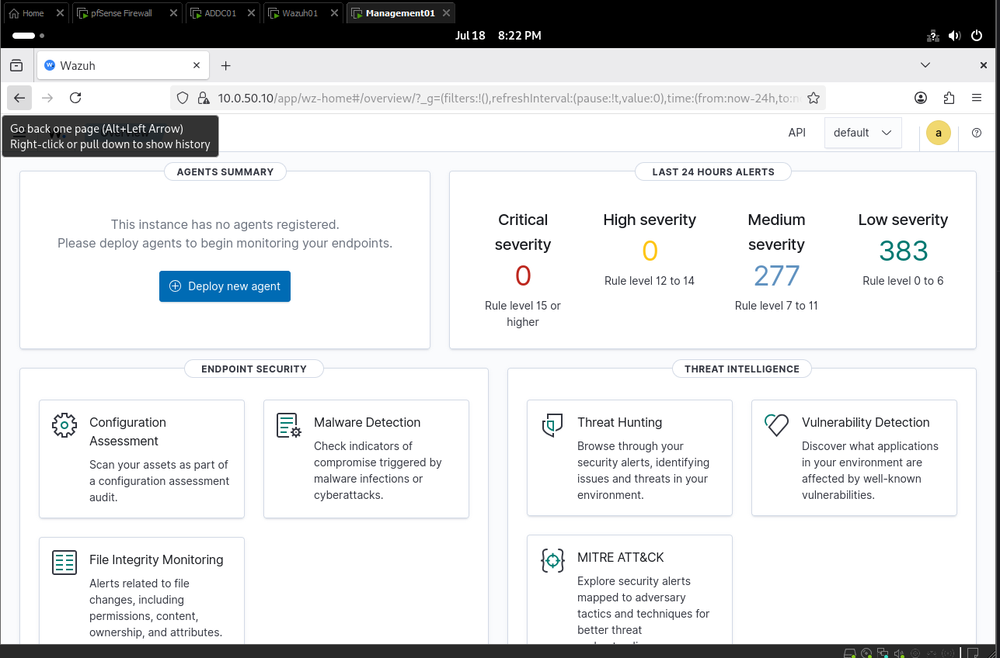
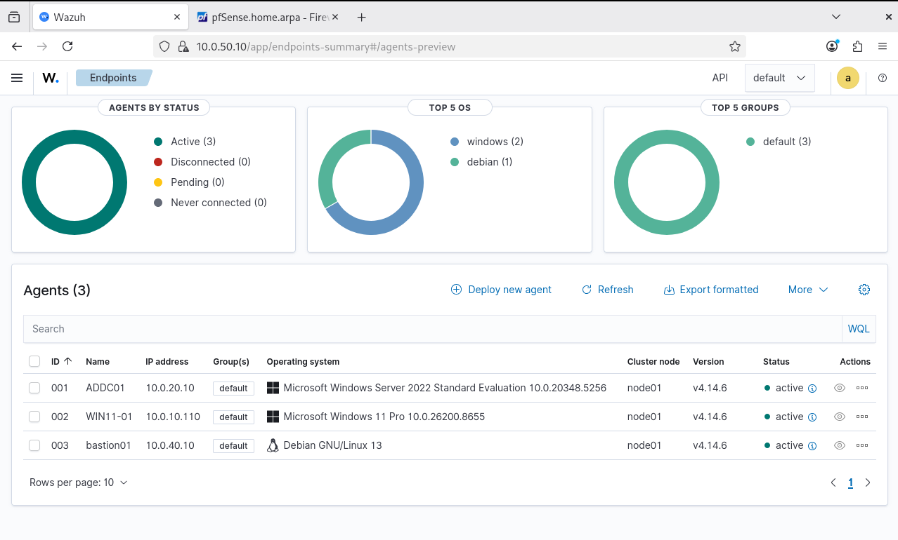

# 7. Wazuh Server (SIEM)

[⬅️ Previous: Sysmon](Deploy_Sysmon_Checho.md) · [Back to README](README.md)

**Wazuh** centralizes logs and telemetry from the lab machines (Windows events, Sysmon, Linux logs) and generates alerts. It's installed on the Security subnet with all three components (indexer, server and dashboard) on a single VM.

## Contents

- [Specs](#specs)
- [pfSense rules for the Security subnet](#pfsense-rules-for-the-security-subnet)
- [Installing Ubuntu Server](#installing-ubuntu-server)
- [Server hardening](#server-hardening)
- [pfSense rules for Wazuh](#pfsense-rules-for-wazuh)
- [Install Wazuh](#install-wazuh)
- [Install the agents](#install-the-agents)

## Specs

| Parameter | Value |
| --------- | ----- |
| Hostname | `WAZUH01` |
| Operating system | Ubuntu Server 24.04 LTS |
| vCPU | 4 |
| RAM | 8 GB (12 GB recommended) |
| Disk | 50 GB |
| Network | Security – `10.0.50.0/27` (OPT4 interface in pfSense) |
| IP | `10.0.50.10` |
| Gateway | `10.0.50.1` |
| DNS | `10.0.20.10` (ADDC01) |

### Wazuh ports

| Port | Protocol | Use | Source |
| ---- | -------- | --- | ------ |
| 443 | TCP | Web dashboard | Management |
| 22 | TCP | Administrative SSH | Management |
| 1514 | TCP | Agent communication | Users, Servers, Management |
| 1515 | TCP | Agent enrollment | Users, Servers, Management |

> Agents initiate the connection to Wazuh; the server doesn't need to open sessions to the endpoints.

---

## pfSense rules for the Security subnet

Before installing, set up the rules on pfSense's Security interface.

### Rule 1 – Internet access (HTTP/HTTPS)

For Ubuntu updates, Wazuh packages and, later on, threat intelligence downloads.

| Action | Interface | Protocol | Source | Destination | Port |
| ------ | --------- | -------- | ------ | ----------- | ---- |
| Pass | Security | IPv4 TCP | Security net | any | 443 |
| Pass | Security | IPv4 TCP | Security net | any | 80 |

### Rule 2 – DNS only to the domain controller

Instead of allowing DNS to any destination, only allow queries to the AD-integrated DNS server:

| Action | Source | Destination | Port |
| ------ | ------ | ----------- | ---- |
| Pass | Security net | `10.0.20.10` | 53 TCP/UDP |

### Rule 3 – NTP

Use pfSense (or the DC) as the time source:

| Action | Source | Destination | Port |
| ------ | ------ | ----------- | ---- |
| Pass | Security net | `10.0.50.1` | 123 UDP |

### Rule 4 – Block traffic to internal networks (optional)

Once the lab is complete, explicitly block unnecessary traffic from Security to other internal networks:

| Action | Source | Destination |
| ------ | ------ | ----------- |
| Block | Security net | Users net |
| Block | Security net | Servers net |
| Block | Security net | DMZ net |

---

## Installing Ubuntu Server

- During installation, check **Install OpenSSH server**. On the *Featured server snaps* screen, don't select any.
- While the install runs, keep a temporary pfSense rule that lets this subnet reach the Internet.

After installing, update and reboot:

```bash
sudo apt update
sudo apt full-upgrade -y
sudo reboot
```

### Static IP with Netplan

1. Find the interface name (usually `eth0`, `enp0s3` or `ens33`):

   ```bash
   ip a
   ```

2. Find the Netplan file (something like `00-installer-config.yaml`, `50-cloud-init.yaml` or `01-netcfg.yaml`):

   ```bash
   ls /etc/netplan/
   sudo nano /etc/netplan/<file>.yaml
   ```

3. Configure the static IP:

   ```yaml
   network:
     version: 2
     renderer: networkd
     ethernets:
       ens33:            # replace with your interface name
         dhcp4: false
         addresses:
           - 10.0.50.10/27
         routes:
           - to: default
             via: 10.0.50.1
         nameservers:
           addresses:
             - 10.0.20.10
   ```

   > ⚠️ YAML doesn't allow tabs: use spaces only and keep the indentation and `-` dashes exactly as shown.

   

4. Restrict the file's permissions (Netplan warns if other users can read it) and apply:

   ```bash
   sudo chown root:root /etc/netplan/<file>.yaml
   sudo chmod 600 /etc/netplan/<file>.yaml
   sudo netplan apply
   ```

   

---

## Server hardening

### 1. Create an administrative user

```bash
sudo adduser sergioadmin
# -a = append (add without removing other groups), -G = group
sudo usermod -aG sudo sergioadmin
```

Test it:

```bash
su - sergioadmin
sudo whoami      # should print: root
```

### 2. Configure SSH

```bash
sudo nano /etc/ssh/sshd_config
```

```text
PermitRootLogin no
PasswordAuthentication no
PubkeyAuthentication yes
KbdInteractiveAuthentication no
UsePAM yes
MaxAuthTries 3
LoginGraceTime 30
X11Forwarding no
```

> ⚠️ With `PasswordAuthentication no`, copy the administrator's public key first (`ssh-copy-id sergioadmin@10.0.50.10`) so you don't lock yourself out.

```bash
sudo sshd -t
sudo systemctl restart ssh
sudo systemctl enable ssh
sudo systemctl status ssh
```

### 3. Install fail2ban

```bash
sudo apt install fail2ban -y
sudo systemctl status fail2ban
```



### 4. Configure ufw

Even though pfSense is the main firewall, a host firewall adds another layer of protection:

```bash
sudo ufw default deny incoming
sudo ufw default allow outgoing
sudo ufw allow from 10.0.40.0/28 to any port 22    # SSH only from Management
```



The rest of the `ufw` rules are added after installing Wazuh.

---

## pfSense rules for Wazuh

Each rule is created on the **source interface** of the traffic.

| Source (interface) | Destination | Ports |
| ------------------ | ----------- | ----- |
| Management (OPT3) | Security | 22 (SSH), 443 (Dashboard), 1514 TCP (bastion agent), 1515 TCP (bastion enrollment) |
| Users (LAN) | Security | 1514 TCP (agent), 1515 TCP (enrollment) |
| Servers (OPT1) | Security | 1514 TCP (agent), 1515 TCP (enrollment) |






---

## Install Wazuh

Follow the official guide: <https://documentation.wazuh.com/current/installation-guide/index.html>

The guide lets you install the **indexer**, **server** and **dashboard** separately; this lab used the **step-by-step** installation with all three components on `WAZUH01`.

> 🔐 When it finishes, the installer prints randomly generated credentials in the terminal. **Store them in a password manager**: they're what you use to log in to the dashboard. Never commit them to the repository or leave them in screenshots.

Check the services:

```bash
sudo systemctl status wazuh-manager
sudo systemctl status wazuh-indexer
sudo systemctl status wazuh-dashboard
```

### ufw rules for Wazuh

```bash
# Dashboard and SSH from Management
sudo ufw allow from 10.0.40.0/28 to any port 443 proto tcp
sudo ufw allow from 10.0.40.0/28 to any port 22 proto tcp

# Agents (1514) from Users, Servers and Management
sudo ufw allow from 10.0.10.0/24 to any port 1514 proto tcp
sudo ufw allow from 10.0.20.0/24 to any port 1514 proto tcp
sudo ufw allow from 10.0.40.0/28 to any port 1514 proto tcp

# Enrollment (1515) from Users, Servers and Management
sudo ufw allow from 10.0.10.0/24 to any port 1515 proto tcp
sudo ufw allow from 10.0.20.0/24 to any port 1515 proto tcp
sudo ufw allow from 10.0.40.0/28 to any port 1515 proto tcp

sudo ufw enable
sudo ufw status numbered
```

### Change the API user passwords

The `wazuh` and `wazuh-wui` API accounts come with installer-generated passwords; you can replace them with your own:

```bash
sudo /var/ossec/framework/python/bin/python3 << 'EOF'
from wazuh.rbac.orm import AuthenticationManager
with AuthenticationManager() as auth:
    print("wazuh:", auth.update_user(user_id=1, password='<NEW_PASSWORD>'))
    print("wazuh-wui:", auth.update_user(user_id=2, password='<NEW_PASSWORD>'))
EOF
sudo systemctl restart wazuh-manager
```

Check that the API accepts the new password (it should return a JWT token):

```bash
curl -u wazuh:'<NEW_PASSWORD>' -k -X POST \
  "https://localhost:55000/security/user/authenticate?raw=true"
```

Update the `wazuh-wui` password in the dashboard configuration, in the `hosts:` section of `/usr/share/wazuh-dashboard/data/wazuh/config/wazuh.yml`, and restart the service:

```bash
sudo systemctl restart wazuh-dashboard
```

> 🔐 Use unique passwords and don't reuse them for other services. Don't run this command in a terminal you're going to screenshot or record.

### Test the dashboard

From the Admin VM, open `https://10.0.50.10` in the browser and log in.



---

## Install the agents

With the dashboard working, install the agents on the machines so they report to Wazuh:

| System | Guide |
| ------ | ----- |
| Windows | <https://documentation.wazuh.com/current/installation-guide/wazuh-agent/wazuh-agent-package-windows.html> |
| Linux | <https://documentation.wazuh.com/current/installation-guide/wazuh-agent/wazuh-agent-package-linux.html> |

Machines with an agent:

| Agent | IP | System |
| ----- | -- | ------ |
| ADDC01 | `10.0.20.10` | Windows Server 2022 |
| WIN11-01 | `10.0.10.110` | Windows 11 Pro |
| bastion01 | `10.0.40.10` | Debian 13 |



---

## Next steps

- Send Sysmon events to Wazuh and verify telemetry
- Harden the DC further
- Build the attacker VM and generate detections
- Integrate Linux with AD
- Add AD CS

[⬅️ Previous: Sysmon](Deploy_Sysmon_Checho.md) · [Back to README](README.md)
