# 4. Domain-joined Windows 11 Workstation

[⬅️ Previous: Active Directory](ActiveDirectory_Checho.md) · [Back to README](README.md) · [Next: Security GPOs ➡️](SecurityBaselineGPOs_Checho.md)

Installing the first user workstation (`WIN11-01`) and joining it to the `corp.lab` domain.

## Specs

| Parameter | Value |
| --------- | ----- |
| Hostname | `WIN11-01` |
| Operating system | Windows 11 **Pro** |
| RAM / Disk | 8 GB / 64 GB |
| Network | Users – `10.0.10.0/24` (LAN interface in pfSense) |
| IP / Gateway | `10.0.10.110` / `10.0.10.1` |
| DNS | `10.0.20.10` (ADDC01) |

---

## Installation

1. Download the official ISO: <https://www.microsoft.com/software-download/windows11>.
2. Create the VM in VMware, connected to the Users network.
3. Install the **Pro** edition: the Home edition can't join a domain.
4. When asked how to set up the device, choose **Set up for work or school**, then the option to **join a domain** instead of using a Microsoft account.

   If that option doesn't appear, press `Shift + F10` to open a terminal and run:

   ```cmd
   OOBE\BYPASSNRO
   ```

   The machine reboots; when you choose *work or school* again, the domain option will be there.

5. Create a local account and finish the installation.
6. Check **Settings → Windows Update** and install any pending updates.

---

## Configuration

1. [Configure the network](#1-configure-the-network)
2. [Verify connectivity](#2-verify-connectivity)
3. [Rename the workstation](#3-rename-the-workstation)
4. [Join the domain](#4-join-the-domain)
5. [Log in with a domain user](#5-log-in-with-a-domain-user)
6. [Move the computer to the Workstations OU](#6-move-the-computer-to-the-workstations-ou)
7. [Verify AD functionality](#7-verify-ad-functionality)
8. [Take a snapshot](#8-take-a-snapshot)

### 1. Configure the network

**Control Panel → Network and Sharing Center → Change adapter settings** → adapter properties → double-click **IPv4**:

| Field | Value |
| ----- | ----- |
| IP Address | `10.0.10.110` |
| Subnet Mask | `255.255.255.0` |
| Gateway | `10.0.10.1` |
| DNS Server | `10.0.20.10` |

> ⚠️ DNS **must** point to the domain controller: Active Directory relies on DNS for machines to find the domain.

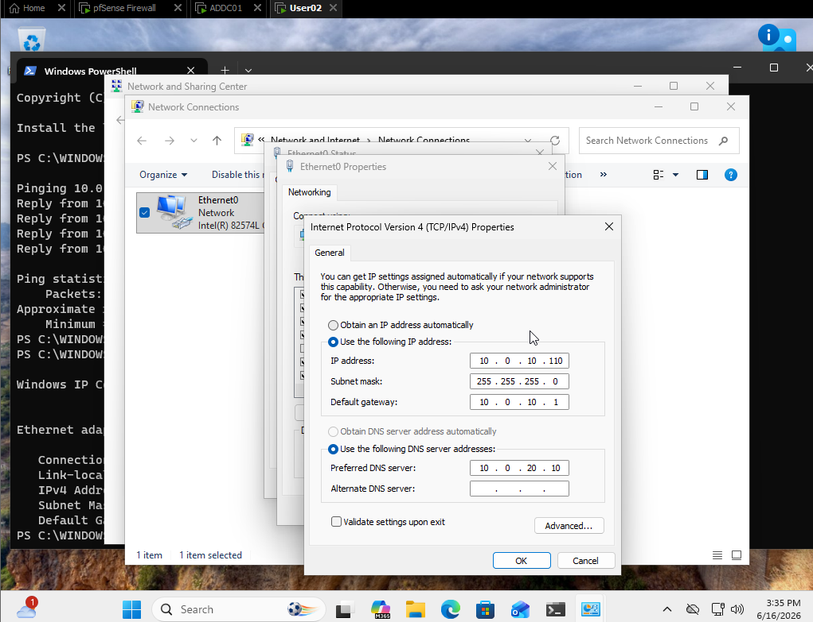

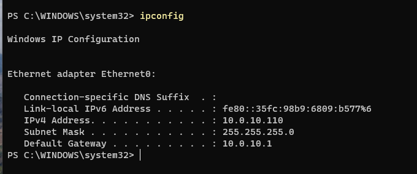

### 2. Verify connectivity

In PowerShell:

```powershell
ping 10.0.10.1          # connectivity to pfSense
ping 10.0.20.10         # connectivity to ADDC01
nslookup addc01.corp.lab
nslookup corp.lab
```

`nslookup addc01.corp.lab` should return:

```text
Name:    addc01.corp.lab
Address: 10.0.20.10
```

and `nslookup corp.lab` should resolve.

> At this point pfSense's LAN only has the default rules (allow all), so these tests should work without any firewall changes.

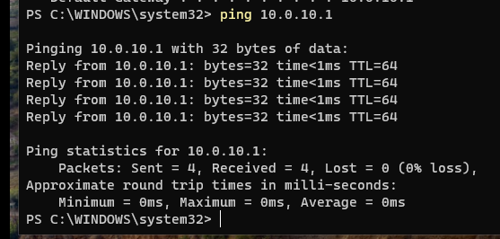

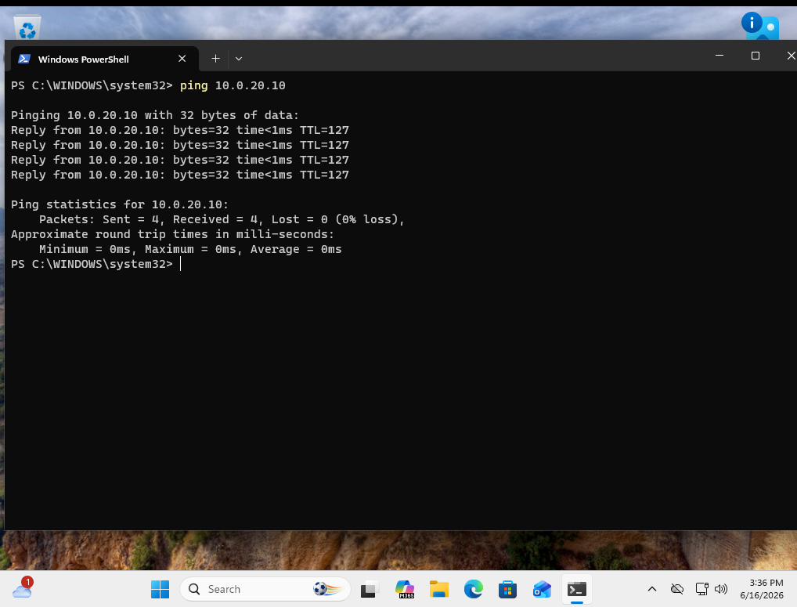

### 3. Rename the workstation

In PowerShell as administrator:

```powershell
Rename-Computer -NewName "WIN11-01" -Restart
```

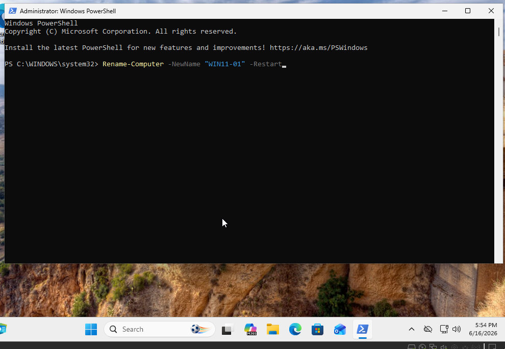

### 4. Join the domain

**Settings → System → About → Domain or workgroup → Change** → choose **Domain** and type `corp.lab`.

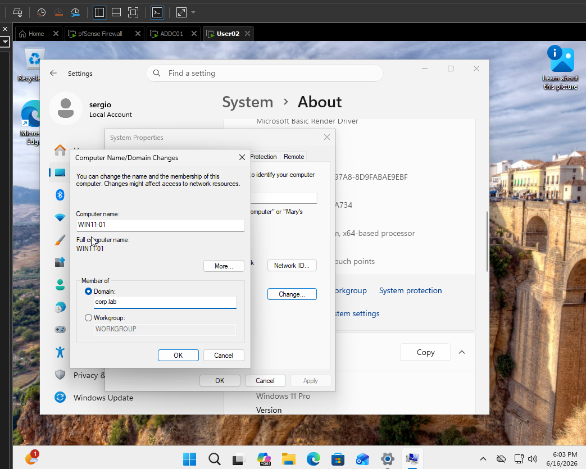

It asks for credentials of an account with domain permissions: use `sergio.admin`. You should see *Welcome to the corp.lab domain*, followed by a reboot prompt.

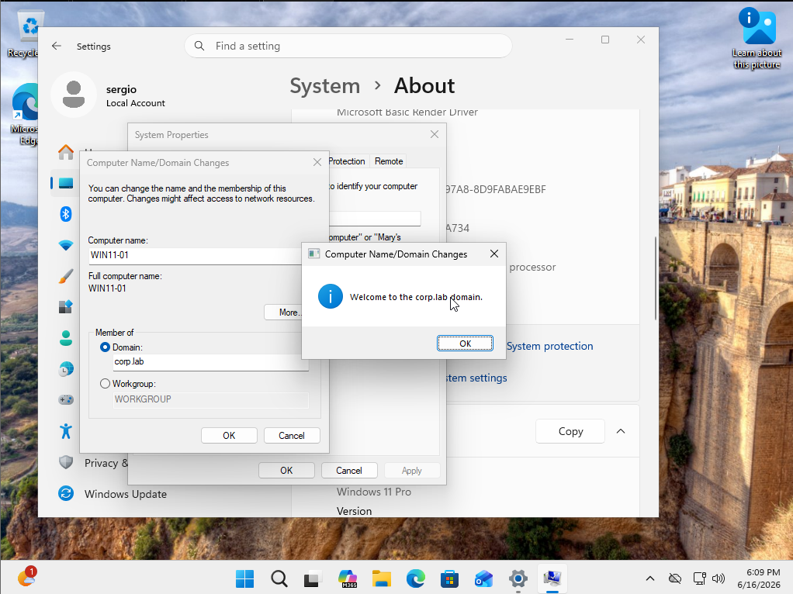

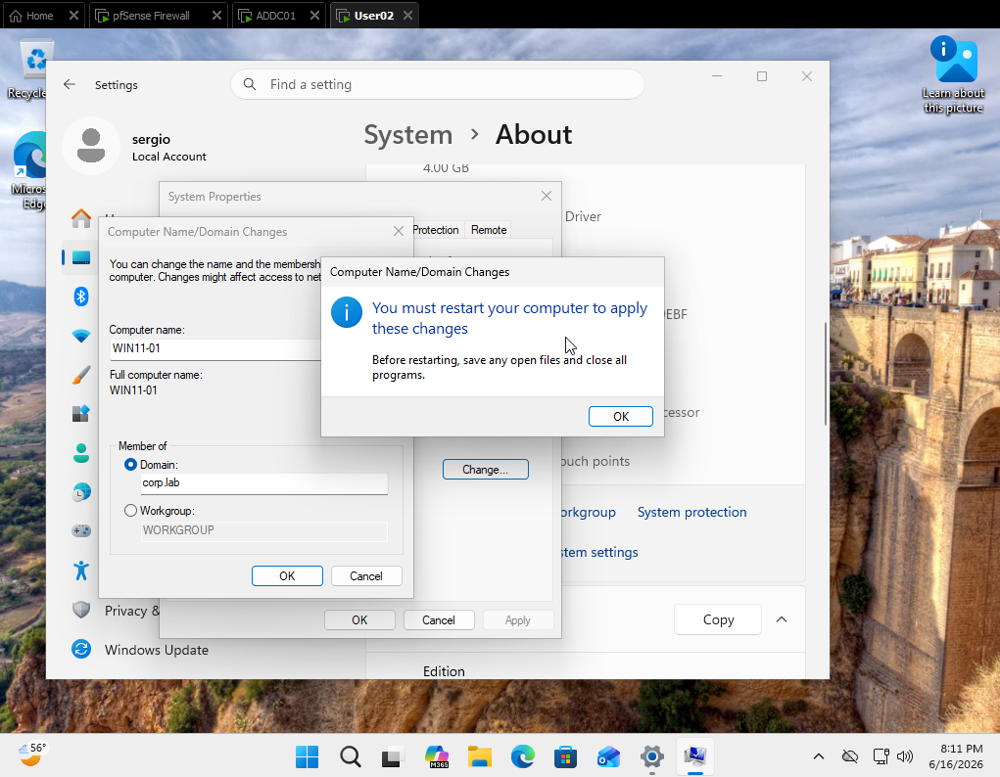

### 5. Log in with a domain user

On the login screen, choose **Other user** and enter the domain account (`sergio` or `sergio@corp.lab`).

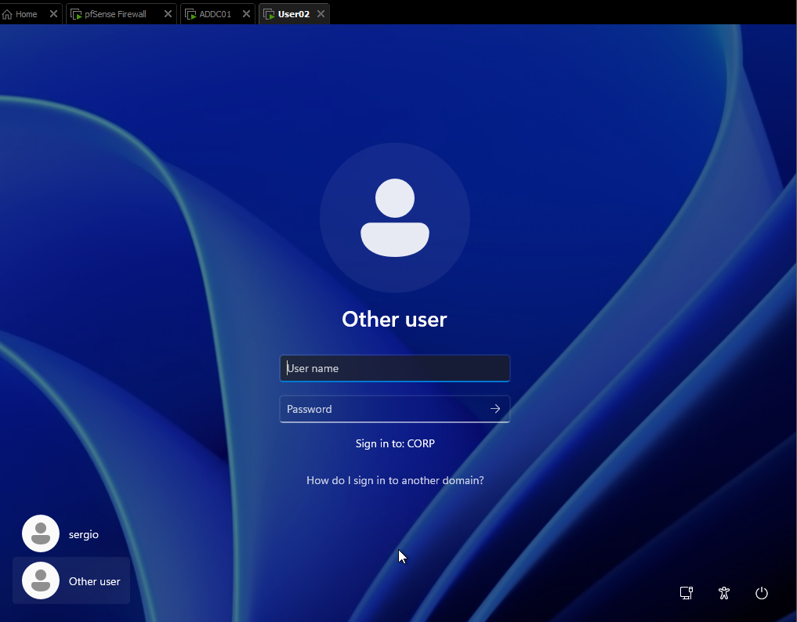

Since the account was created with *User must change password at next logon*, Windows asks for a new password. After that you get the first-time welcome screen, as if it were a fresh install.

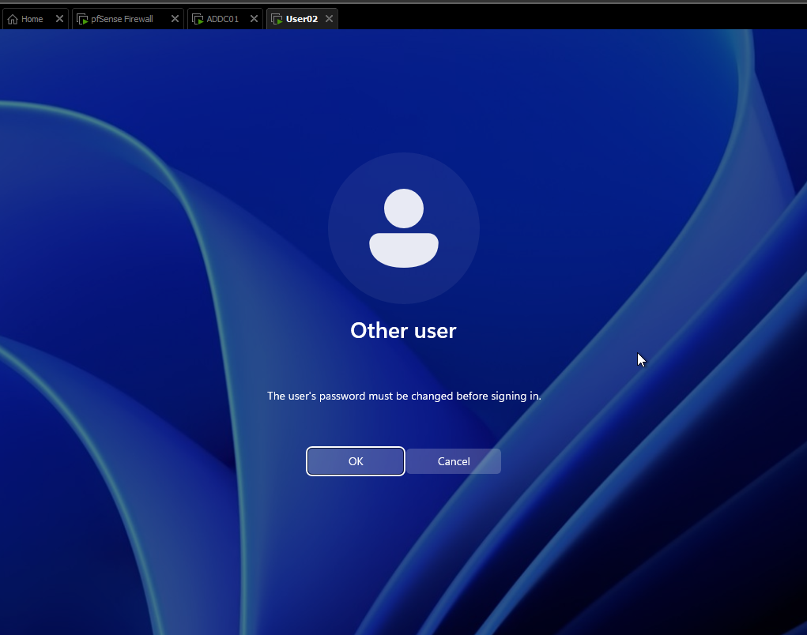

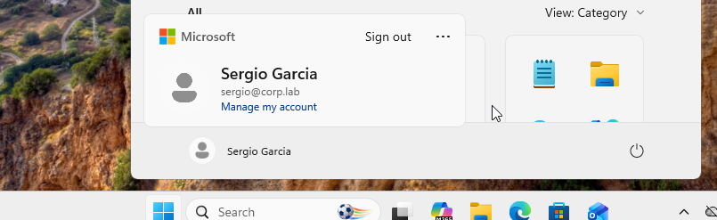

### 6. Move the computer to the Workstations OU

On `ADDC01`: **Server Manager → Tools → Active Directory Users and Computers**. The `WIN11-01` computer shows up in the `Computers` container:

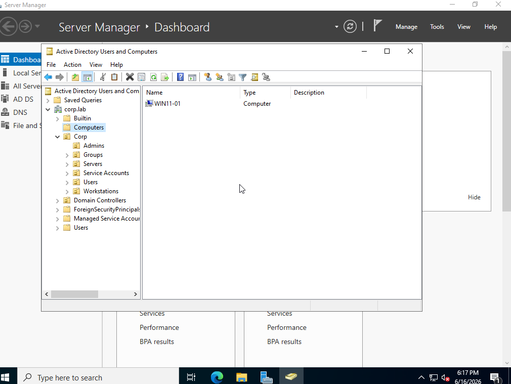

Move it to **Corp → Workstations**, confirm the warning with *Yes*, and check that it landed in the right OU (that's how it will receive the workstation GPOs):

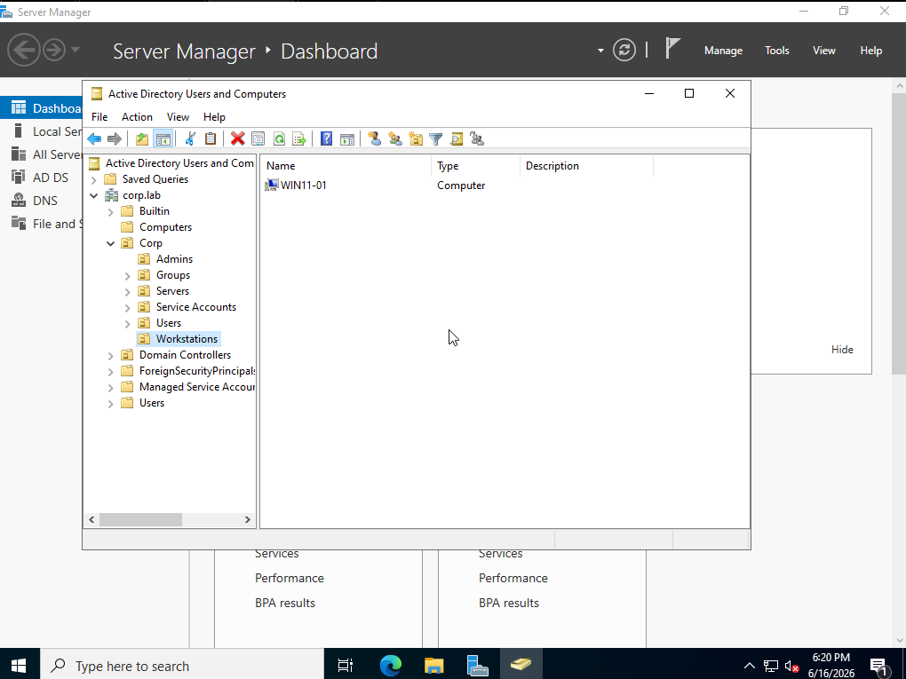

### 7. Verify AD functionality

On `WIN11-01` (cmd):

```cmd
whoami                 :: corp\sergio
echo %logonserver%     :: \\ADDC01
gpupdate /force        :: should complete without errors
gpresult /r            :: shows the policies received from the domain
```

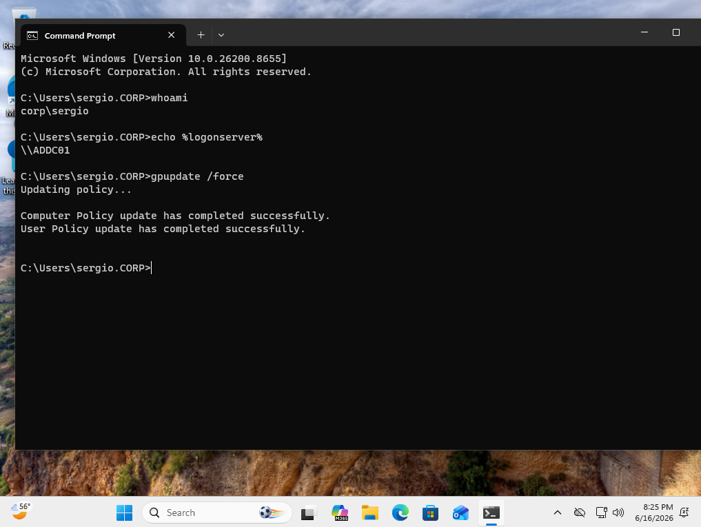

### 8. Take a snapshot

📸 **"WIN11-01 - Joined to Domain"**.

[⬅️ Previous: Active Directory](ActiveDirectory_Checho.md) · [Back to README](README.md) · [Next: Security GPOs ➡️](SecurityBaselineGPOs_Checho.md)
